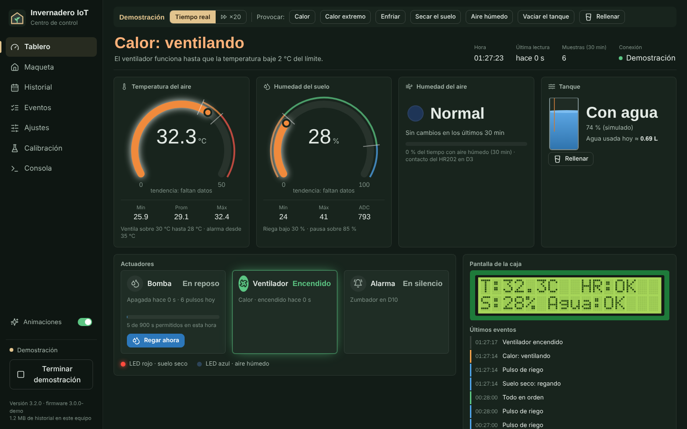
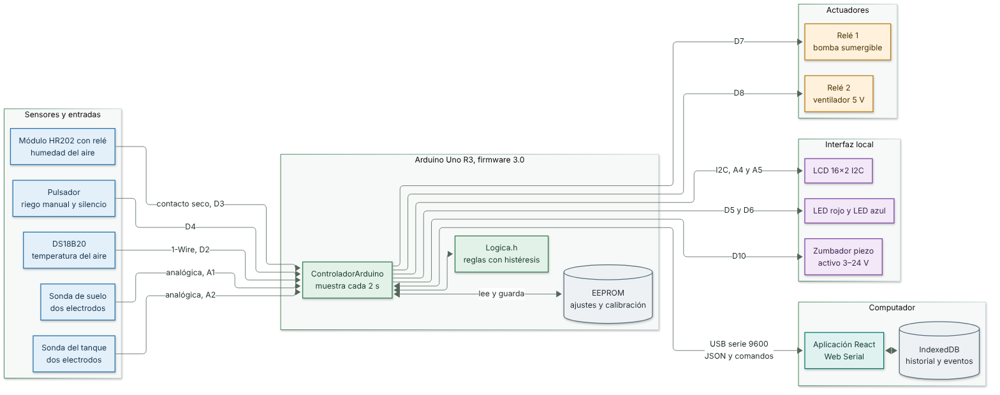
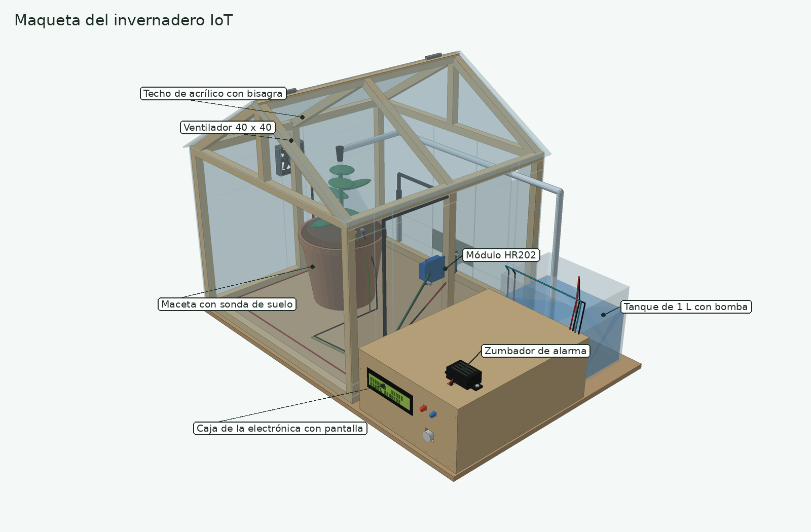
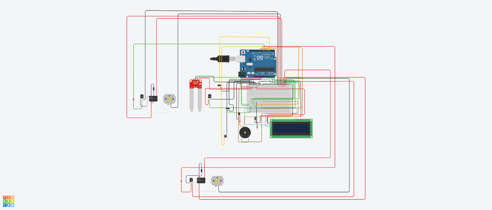

# Smart Greenhouse IoT

[](https://github.com/maiwxzs/greenhouse-iot-firmware/actions/workflows/firmware.yml)
[](https://github.com/maiwxzs/greenhouse-iot-firmware/actions/workflows/aplicacion.yml)
[](LICENSE)
[](LICENSE-docs.md)

Invernadero a escala controlado por un Arduino Uno. El sistema mide la temperatura del aire, la humedad del aire, la humedad del suelo y el nivel del tanque. Con esas lecturas ventila y riega por sí solo. Informa en el sitio con una pantalla LCD, dos LEDs y un zumbador, y en el computador con una aplicación de escritorio conectada por USB.



## Funciones

- **Ventilación** cuando la temperatura supera el límite configurado o el aire está húmedo. Se apaga con histéresis para que el ventilador no arranque y pare a cada momento.
- **Riego por pulsos** de 5 s cuando la tierra está seca, con 1 min de pausa entre pulsos y un máximo de 15 min de bomba por hora. No riega si el tanque está vacío o la tierra está encharcada.
- **Alarma** con zumbador por tanque vacío, temperatura crítica o falla del sensor de temperatura. Se silencia con el pulsador o desde la aplicación.
- **Configuración sin reprogramar:** los umbrales y la calibración se cambian con comandos por USB y quedan guardados en la EEPROM.
- **Alimentación solo por el USB del Arduino:** el firmware nunca enciende la bomba y el ventilador a la vez, para no superar los 500 mA del puerto.
- **Falla segura:** si el sensor de temperatura deja de responder, el ventilador queda encendido y suena la alarma.
- **Historial en el computador:** la aplicación guarda las lecturas, los eventos y estadísticas diarias en el disco, sin usar la memoria del Arduino.

## Arquitectura



| Diagrama | Contenido |
|---|---|
| [Arquitectura del sistema](docs/diagramas/arquitectura-sistema.png) | Sensores, actuadores e interfaces con sus pines |
| [Capas del firmware](docs/diagramas/firmware-capas.png) | Archivos y clases, de `main.cpp` a la lógica pura |
| [Ciclo de control](docs/diagramas/ciclo-control.png) | Una vuelta de `loop()` y las decisiones de cada muestra |
| [Estados con histéresis](docs/diagramas/estados-control.png) | Temperatura, humedad del suelo y humedad del aire |
| [Diagrama de clases](docs/diagramas/uml-clases.png) | UML del firmware |
| [Secuencia aplicación ↔ Arduino](docs/diagramas/secuencia-app-arduino.png) | Conexión, sincronización de la hora, telemetría y comandos |
| [Arquitectura de la aplicación](docs/diagramas/aplicacion-arquitectura.png) | Componentes React, datos e IndexedDB |
| [Mensajes del protocolo](docs/diagramas/protocolo-mensajes.png) | Campos de `tel`, `cfg`, respuestas y comandos |

Cada diagrama está en SVG, PNG y draw.io en [`docs/diagramas/`](docs/diagramas/).

## Hardware

| Componente | Función | Pin |
|---|---|---|
| Arduino Uno R3 (clon CH340G) | Controlador | — |
| Sonda DS18B20 sumergible + resistencia de 4.7 kΩ | Temperatura del aire | D2 |
| Módulo de humedad HR202 con relé (contacto NO/COM) | Humedad del aire alta o normal | D3 |
| Pulsador de 12 mm | Riego manual y silencio de la alarma | D4 |
| LED rojo y LED azul de 5 mm + 220 Ω | Suelo seco y aire húmedo | D5, D6 |
| Módulo relé 1 + mini bomba sumergible 3–6 V | Riego | D7 |
| Módulo relé 2 + ventilador 5 V de 40 × 40 mm | Ventilación | D8 |
| Zumbador piezoeléctrico activo 3–24 V | Alarma | D10 |
| Sonda de suelo de dos clavos | Humedad del suelo | A1 |
| Sonda de nivel de dos cables | Agua en el tanque | A2 |
| LCD 16×2 con módulo I2C | Pantalla | A4 (SDA), A5 (SCL) |

- Cableado, alimentación y consumo: [`hardware/circuits/conexiones.md`](hardware/circuits/conexiones.md)
- Lista de materiales con especificaciones y medidas: [`hardware/bom/BOM.md`](hardware/bom/BOM.md)

## Lógica de control

| Situación | Respuesta |
|---|---|
| Temperatura sobre 30 °C | Ventilador hasta que baje de 28 °C |
| Temperatura de 35 °C o más | Además, alarma sonora |
| Contacto del módulo HR202 cerrado (aire húmedo) | Ventilador y LED azul |
| Suelo bajo 30 % | Riego por pulsos y LED rojo |
| Suelo sobre 85 % | Riego bloqueado |
| Tanque vacío | Bomba bloqueada, LED rojo intermitente y alarma |
| DS18B20 sin respuesta | Ventilador por seguridad, LEDs alternados y alarma |

Los valores son los de fábrica y se cambian con comandos como `TEMP 28` o `SUELOMIN 35` ([protocolo serie](docs/protocolo-serie.md)). El umbral de humedad del aire se fija con el potenciómetro del propio módulo HR202.

## Aplicación de escritorio


**Invernadero IoT** es una aplicación para Windows 10 y 11 que se instala con un instalador `.exe` y se conecta al Arduino por el cable USB. Complementa al firmware: el Arduino mide, decide y envía una lectura cada 2 s; la aplicación muestra, guarda y analiza, sin ocupar memoria del Arduino.

- **Tablero en tiempo real:** la pantalla principal muestra el estado, medidores de temperatura y humedad del suelo con sus zonas, mínimos, máximos y tendencia, la humedad del aire, el tanque, la bomba, el ventilador y la alarma con su tiempo en el estado actual, la réplica de la LCD, los últimos eventos y gráficas de 30 minutos.
- **Maqueta interactiva:** la misma maqueta del repositorio, con sus medidas y materiales, se mueve con los datos reales. El ventilador gira con inercia y el aire cruza la planta, el agua corre por la manguera y gotea sobre la maceta, la tierra cambia de color con la humedad, las hojas caen con el suelo seco, el tanque baja, aparece rocío en el acrílico con el aire húmedo y el zumbador emite ondas con la alarma. Cada pieza se toca para ver qué es, cómo está conectada, qué hace en ese momento y, cuando corresponde, para actuar: regar, silenciar la alarma o levantar la tapa de la caja para ver el Arduino, la protoboard y los relés.
- **Réplica de la pantalla LCD:** muestra exactamente lo que escribe la pantalla de la caja, con la misma matriz de puntos y las mismas dos páginas.
- **Historial y eventos:** lecturas de los últimos 2 días y resúmenes por minuto de 180 días guardados en el equipo, estadísticas diarias y exportación a CSV.
- **Ajustes, calibración y consola** de comandos.
- **Demostración:** un Arduino simulado con el mismo protocolo, a velocidad real o ×20, con botones para provocar calor, sequía, aire húmedo o tanque vacío y ver cómo reacciona el control.

El instalador se descarga de la sección [**Releases**](https://github.com/maiwxzs/greenhouse-iot-firmware/releases) del repositorio. GitHub Actions lo construye con Electron en cada cambio de `app/`. Instalación y uso en el [manual de usuario](docs/manual-usuario.md#aplicación-de-escritorio); detalles técnicos en [`app/README.md`](app/README.md).

## Maqueta



Base de MDF de 47 × 31 cm. Invernadero de 30 × 30 cm con estructura de balso de 10 × 10 mm, paredes y techo de acrílico de 2 mm y 31 cm de altura en la cumbrera. A su lado, una caja de MDF de 15 × 20 × 7.5 cm con la electrónica, y detrás de ella el tanque de 1 L con la bomba. Materiales, piezas, uniones y recorrido de cada cable en [`docs/maqueta.md`](docs/maqueta.md).

- Modelos 3D en STL y OBJ con colores: [`hardware/3d-models/`](hardware/3d-models/)
- Renders, planos de corte y distribución: [`hardware/maqueta/`](hardware/maqueta/)

## Firmware

```bash
cd firmware
pio test -e native     # 25 pruebas de la lógica, en el computador
pio run -e uno -t upload
pio device monitor     # 9600 baudios
```

Con el Arduino IDE: copia `firmware/src/main.cpp` como `Invernadero/Invernadero.ino`, junto con los tres archivos de `firmware/include/`, e instala las librerías **OneWire**, **DallasTemperature** y **LiquidCrystal I2C**.

La lógica de decisión (`Logica.h`) no depende de Arduino y está cubierta por pruebas unitarias. En el Arduino Uno el firmware usa 1342 de 2048 bytes de RAM (65.5 %) y 25 508 de 32 256 bytes de flash (79.1 %); sin pantalla, 52.4 % y 65.1 %. GitHub Actions corre esas pruebas, compila el firmware con y sin pantalla e informa el uso de memoria en cada cambio.

## Simulación en Tinkercad

[`tinkercad/invernadero_tinkercad.ino`](tinkercad/invernadero_tinkercad.ino) es el mismo control adaptado a las piezas disponibles en Tinkercad Circuits (TMP36, interruptor deslizante en lugar del contacto del HR202, relés con transistor y motores DC). Piezas, cableado, pruebas y diferencias con el equipo real: [`docs/tinkercad.md`](docs/tinkercad.md).

[Abrir el circuito en Tinkercad](https://www.tinkercad.com/things/ckFm3G2RFop-fabulous-densor-waasa/editel?returnTo=https%3A%2F%2Fwww.tinkercad.com%2Fdashboard&sharecode=71Am6oTvSApW-1JlmwnVTSqvfnvpZX53oYo7AuHwRA4)



## Estructura del repositorio

```
greenhouse-iot-firmware/
├── firmware/                    Código del Arduino (PlatformIO)
│   ├── include/
│   │   ├── Config.h             Pines, partes instaladas y valores de fábrica
│   │   ├── Logica.h             Decisiones sin hardware (probadas)
│   │   └── GreenhouseCore.hpp   Sensores, actuadores, pantalla y controlador
│   ├── src/main.cpp             setup() y loop()
│   └── test/test_logica/        Pruebas unitarias
├── app/                         Aplicación de escritorio (Electron + React)
│   ├── electron/                Proceso principal y acceso al puerto USB
│   ├── src/                     Interfaz: maqueta interactiva, vistas y datos
│   └── recursos/                Ícono del instalador
├── tinkercad/                   Versión para Tinkercad Circuits
├── hardware/
│   ├── circuits/                Esquema y documentación de conexiones
│   ├── bom/                     Lista de materiales
│   ├── 3d-models/               Maqueta en STL y OBJ
│   └── maqueta/                 Renders, planos de corte y distribución
├── docs/
│   ├── especificacion-tecnica.md
│   ├── manual-usuario.md
│   ├── protocolo-serie.md
│   ├── maqueta.md
│   ├── tinkercad.md
│   ├── diagramas/               SVG, PNG y draw.io
│   └── img/
├── tools/                       Generadores de diagramas, esquema y maqueta
└── .github/workflows/           Integración continua
```

## Documentación

| Documento | Contenido |
|---|---|
| [Especificación técnica](docs/especificacion-tecnica.md) | Requisitos, arquitectura, control, energía, fallas, pruebas y limitaciones |
| [Manual de usuario](docs/manual-usuario.md) | Operación, indicadores, aplicación, calibración y solución de problemas |
| [Protocolo serie](docs/protocolo-serie.md) | Comandos y mensajes JSON |
| [Conexiones](hardware/circuits/conexiones.md) | Pines, cableado de cada componente y consumo |
| [Lista de materiales](hardware/bom/BOM.md) | Electrónica y maqueta, con especificaciones |
| [Maqueta](docs/maqueta.md) | Materiales, dimensiones, construcción y cableado |
| [Tinkercad](docs/tinkercad.md) | Circuito simulado y diferencias con el real |
| [Aplicación de escritorio](app/README.md) | Arquitectura, maqueta interactiva, almacenamiento y construcción del instalador |
| [Diagramas](docs/diagramas/README.md) | Índice y edición |
| [Herramientas](tools/README.md) | Cómo se generan los archivos de diseño |
| [Contribuir](CONTRIBUTING.md) | Flujo de trabajo y convenciones |
| [Cambios](CHANGELOG.md) | Versiones |

## Equipo

Proyecto de la asignatura **Tecnologías Avanzadas**, docente Wolfang Corredor.

- Maicol Beltrán
- Julián Ortiz
- Andrés López
- Julián Urquiza
- María Callejas

En GitHub: **maiwxzs**, **pautthh**, **lopezand2701**, **jdavidortiz2004-tech**.

## Licencia

El código (`firmware/`, `app/`, `tinkercad/`, `tools/`) se publica bajo la licencia [MIT](LICENSE). La documentación, los diagramas y los diseños de hardware y de la maqueta, bajo [CC BY 4.0](LICENSE-docs.md).
