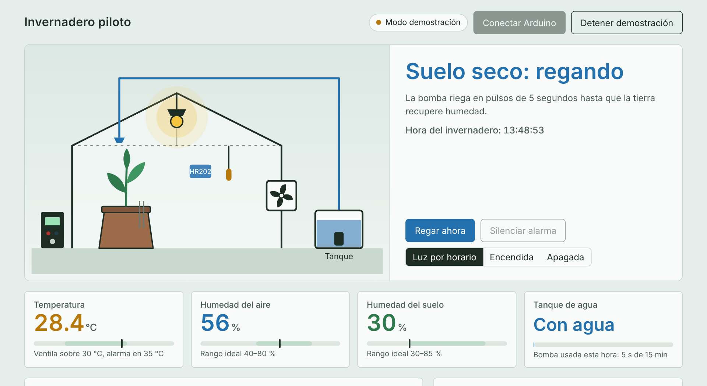
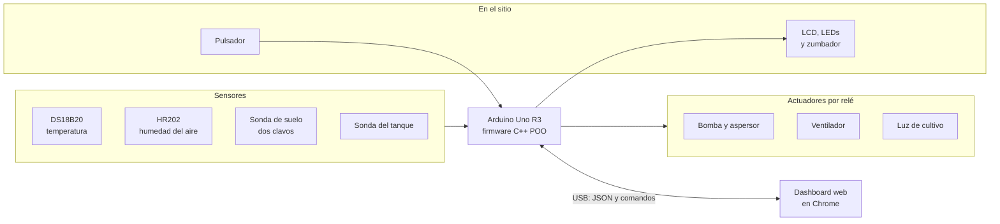
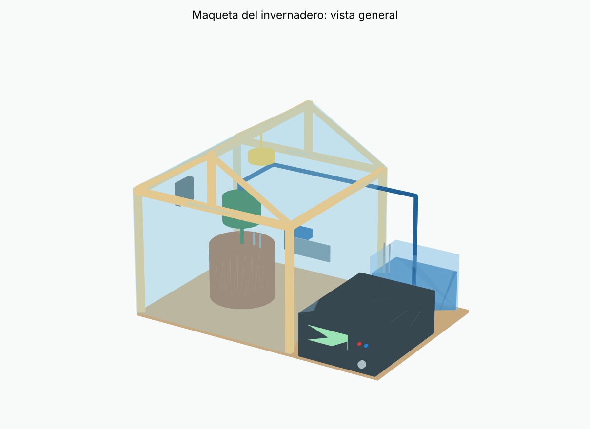

# Smart Greenhouse IoT

[](https://github.com/maiwxzs/greenhouse-iot-firmware/actions/workflows/firmware.yml)
[](LICENSE)
[](LICENSE-docs.md)

Invernadero automatizado con Arduino Uno. Mide temperatura, humedad del aire, humedad del suelo y el nivel del tanque. Con esas lecturas decide solo cuándo ventilar, regar o encender la luz. Avisa en el sitio con pantalla, LEDs y zumbador, y en el computador con un dashboard web por USB.



## Qué hace

- **Ventila** cuando hace calor o el aire está muy húmedo.
- **Riega en pulsos de 5 s** cuando la tierra o el aire están secos. No riega si el tanque está vacío o la tierra está encharcada, y respeta el límite de uso de la bomba.
- **Enciende la luz de cultivo** según un horario.
- **Avisa** con LED rojo (humedad baja), LED azul (humedad alta), pantalla LCD y alarma sonora.
- **Se configura sin reprogramar:** umbrales, horario y calibración por comandos o desde el dashboard. Todo queda guardado en la EEPROM.
- **Funciona solo con el USB del Arduino:** reparte la energía para no superar los 500 mA.
- **Falla de forma segura:** si se desconecta un sensor, el sistema lo detecta y actúa con precaución.

## Arquitectura



Más diagramas (bloques del firmware, flujo de control, UML, estados, secuencia) en [`docs/diagramas/`](docs/diagramas/), en Mermaid, SVG, PNG y draw.io.

## Hardware

| Componente | Función | Pin |
|---|---|---|
| Arduino Uno R3 (clon CH340G) | Controlador | — |
| DS18B20 sumergible + resistencia de 4.7 kΩ | Temperatura | D2 |
| Módulo HR202 (LM393) | Humedad del aire | A0 (AO), D3 (DO) |
| Sonda casera de dos clavos | Humedad del suelo | A1 |
| Sonda casera de dos cables | Nivel del tanque | A2 |
| Módulo relé 5 V + mini bomba sumergible | Aspersor | D7 |
| Módulo relé 5 V + mini ventilador 5 V | Ventilación | D8 |
| Módulo relé 5 V + lámpara LED USB | Luz de cultivo | D9 |
| LED rojo y LED azul + 220 Ω | Humedad baja y alta | D5, D6 |
| Zumbador | Alarma | D10 |
| Pulsador | Riego manual y silencio | D4 |
| LCD 16×2 con módulo I2C | Pantalla | A4 (SDA), A5 (SCL) |

- Esquema, cableado de los relés, sondas caseras y alimentación: [`hardware/circuits/conexiones.md`](hardware/circuits/conexiones.md)
- Lista de materiales (comprado, por comprar y hecho en casa): [`hardware/bom/BOM.md`](hardware/bom/BOM.md)

## Cómo empezar

### 1. Armar el circuito

Sigue [`hardware/circuits/conexiones.md`](hardware/circuits/conexiones.md). Si alguna parte opcional no está conectada (LCD, zumbador, luz, sondas), desactívala en [`firmware/include/Config.h`](firmware/include/Config.h).

### 2. Cargar el firmware

**Con PlatformIO (VS Code):**

```bash
cd firmware
pio run -t upload        # compila y carga al Arduino (las librerías se descargan solas)
pio device monitor       # monitor serie a 9600 baudios
```

**Con el Arduino IDE:**

1. Crea una carpeta llamada `Invernadero`.
2. Copia ahí `firmware/src/main.cpp` y cámbiale el nombre a `Invernadero.ino`.
3. Copia en la misma carpeta los tres archivos de `firmware/include/` (`Config.h`, `Logica.h` y `GreenhouseCore.hpp`).
4. En *Herramientas → Administrar bibliotecas*, instala **OneWire** (Paul Stoffregen), **DallasTemperature** (Miles Burton) y **LiquidCrystal I2C** (Frank de Brabander).
5. Elige la placa **Arduino Uno** y carga el programa. Si el puerto no aparece, instala el driver **CH340**.

### 3. Calibrar y probar

Sigue el [manual de usuario](docs/manual-usuario.md): calibración de los sensores en 5 pasos y una tabla para probar cada parte.

### 4. Abrir el dashboard

Abre [`dashboard/index.html`](dashboard/index.html) en **Chrome o Edge**, pulsa **Conectar Arduino** y elige el puerto. Sin el Arduino, **Probar sin Arduino** muestra datos simulados.

> **Opcional: dashboard en línea.** En GitHub, entra a *Settings → Pages* y elige *Deploy from a branch → main → / (root)*. El dashboard quedará en `https://maiwxzs.github.io/greenhouse-iot-firmware/dashboard/` y se podrá abrir desde cualquier computador con Chrome, sin descargar el repositorio.

## Lógica de control

| Situación | Respuesta |
|---|---|
| Temperatura sobre 30 °C | Ventilador hasta que baje de 28 °C |
| Temperatura de 35 °C o más | Además, alarma |
| Suelo bajo 30 % | Riego en pulsos (5 s, pausa de 1 min, máx. 15 min/h) y LED rojo |
| Aire bajo 40 % con el suelo bien | Nebulización en pulsos y LED rojo |
| Aire sobre 80 % | Ventilador y LED azul |
| Suelo sobre 85 % | No riega |
| Tanque vacío | Bomba bloqueada, LED rojo parpadea y alarma |
| Sensor de temperatura desconectado | Ventilador por seguridad, LEDs alternados y alarma |
| Horario de luz (6:00 a 18:00) | Luz encendida |

Todos los umbrales se cambian con comandos (`TEMP 28`, `HUMMIN 45`, `LUZ 7 19`…). Ver el [protocolo serie](docs/protocolo-serie.md).

Con alimentación solo por USB, nunca funcionan dos cargas a la vez. La prioridad es bomba, luego ventilador, luego luz.

## Simulación en Tinkercad

[`tinkercad/invernadero_tinkercad.ino`](tinkercad/invernadero_tinkercad.ino) es el mismo sistema adaptado a las piezas de Tinkercad Circuits (TMP36, potenciómetro, relés con transistor, motores DC). Guía completa con cableado y pruebas: [`docs/tinkercad.md`](docs/tinkercad.md).

## Maqueta



La maqueta mide 46 × 30 cm de base. Tiene el invernadero de balso y acetato, una caja aparte para la electrónica y el tanque de agua. Incluye:
- **Modelos 3D:** [`hardware/3d-models/`](hardware/3d-models/), en STL. GitHub los muestra en 3D y Tinkercad puede importarlos.
- **Planos de corte con medidas:** [`hardware/maqueta/planos-de-corte.svg`](hardware/maqueta/planos-de-corte.svg).
- **Guía de montaje paso a paso:** [`docs/montaje-maqueta.md`](docs/montaje-maqueta.md).

Las medidas se cambian en [`tools/generar_maqueta.py`](tools/generar_maqueta.py).

## Pruebas y calidad

- **Pruebas unitarias:** 25 pruebas de la lógica (histéresis, riego, energía, reloj, comandos, validación de ajustes). Corren en el computador con `pio test -e native`.
- **Integración continua:** en cada cambio, GitHub Actions corre las pruebas, compila el firmware para el Uno (con y sin LCD) y reporta la memoria.
- **Memoria del Arduino Uno:** RAM 1448 de 2048 bytes (70.7 %); flash 29 054 de 32 256 bytes (90.1 %).

## Estructura del repositorio

```
greenhouse-iot-firmware/
├── firmware/                     Código del Arduino (proyecto PlatformIO)
│   ├── include/
│   │   ├── Config.h              Pines, partes instaladas, valores de fábrica
│   │   ├── Logica.h              Decisiones sin hardware (probadas)
│   │   └── GreenhouseCore.hpp    Clases de sensores, actuadores y control
│   ├── src/main.cpp              setup() y loop()
│   ├── test/test_logica/         Pruebas unitarias
│   └── platformio.ini
├── dashboard/index.html          Dashboard web (Web Serial)
├── tinkercad/                    Versión para simular en Tinkercad
├── hardware/
│   ├── circuits/                 Esquema y guía de conexiones
│   ├── bom/                      Lista de materiales
│   ├── 3d-models/                Maqueta en STL
│   └── maqueta/                  Planos de corte y renders
├── docs/
│   ├── especificacion-tecnica.md
│   ├── manual-usuario.md
│   ├── protocolo-serie.md
│   ├── tinkercad.md
│   ├── montaje-maqueta.md
│   ├── diagramas/                Mermaid → SVG, PNG y draw.io
│   ├── img/
│   └── historial/                Diseño inicial (PDF, UML y diagramas)
├── tools/                        Generadores de esquema, maqueta y diagramas
├── .github/workflows/            Compilación y pruebas automáticas
├── CHANGELOG.md
├── CONTRIBUTING.md
├── LICENSE                       MIT (código)
└── LICENSE-docs.md               CC BY 4.0 (documentación y diseños)
```

## Del UML al código

El código sigue el diagrama de clases del diseño inicial ([`docs/historial/uml-inicial.jpg`](docs/historial/uml-inicial.jpg)), ampliado para el hardware definitivo. El diagrama actualizado está en [`docs/diagramas/uml-clases.png`](docs/diagramas/uml-clases.png).

| Clase en el UML inicial | Clase en el código | Cambio |
|---|---|---|
| `Sensor` (abstracta) | `Sensor` | `obtenerLectura(ahora)` guarda una `LecturaDato` |
| `SensorDHT11` | `SensorTemperatura` | DS18B20, lectura no bloqueante |
| `SensorHumedad` (YL-69) | `SensorHumedad` | HR202, humedad del aire |
| — | `SondaResistiva` → `SensorHumedadSuelo`, `SensorNivelAgua` | Sondas caseras |
| `Actuador` (abstracta) | `Actuador` | Se añaden `inicializar()` y `actualizar()` |
| `ServomotorEscotilla` | `ActuadorRele` → `BombaAgua`, `Ventilador`, `LuzCultivo` | Hardware definitivo |
| `IndicadorLED` | `IndicadorLED` | Se añade `parpadear()` |
| — | `Zumbador`, `BotonPulsador`, `PantallaLCD` | Interfaz en el sitio |
| `ReglaControl` | `ReglaControl` | Suelo, tanque, temperatura crítica e histéresis |
| `LecturaDato` | `LecturaDato` | Campo `valida` (antes `valor >= 0`, que fallaba bajo cero) |
| `ControladorArduino` | `ControladorArduino` | Comandos, energía, alarma, telemetría |
| `Invernadero` | `Invernadero` | Igual |
| — | `CicloTrabajoBomba`, `RelojSoftware`, `Ajustes`, `AlmacenAjustes` | Lógica y persistencia |

## Documentación

| Documento | Para qué |
|---|---|
| [Especificación técnica](docs/especificacion-tecnica.md) | Requisitos, arquitectura, lógica, energía, fallas, pruebas, limitaciones |
| [Manual de usuario](docs/manual-usuario.md) | Uso diario, LEDs y pantalla, dashboard, calibración, solución de problemas |
| [Protocolo serie](docs/protocolo-serie.md) | Comandos y formato de los datos |
| [Conexiones](hardware/circuits/conexiones.md) | Cableado completo y alimentación |
| [Lista de materiales](hardware/bom/BOM.md) | Electrónica y maqueta |
| [Tinkercad](docs/tinkercad.md) | Simulación del circuito |
| [Montaje de la maqueta](docs/montaje-maqueta.md) | Construcción paso a paso |
| [Diagramas](docs/diagramas/) | Cómo verlos y editarlos |
| [Cómo trabajar en el proyecto](CONTRIBUTING.md) | Flujo con Git, pruebas y convenciones |
| [Cambios](CHANGELOG.md) | Historial de versiones |

## Equipo

Proyecto de la asignatura **Tecnologías Avanzadas**, docente Wolfang Corredor.

- Maicol Beltrán
- Julián Ortiz
- Andrés López
- Julián Urquiza
- María Callejas

En GitHub: **maiwxzs**, **pautthh**, **lopezand2701**, **jdavidortiz2004-tech**.

## Licencia

El código (`firmware/`, `dashboard/`, `tinkercad/`, `tools/`) está bajo la licencia [MIT](LICENSE). La documentación, los diagramas y los diseños de hardware y de la maqueta, bajo [CC BY 4.0](LICENSE-docs.md).
