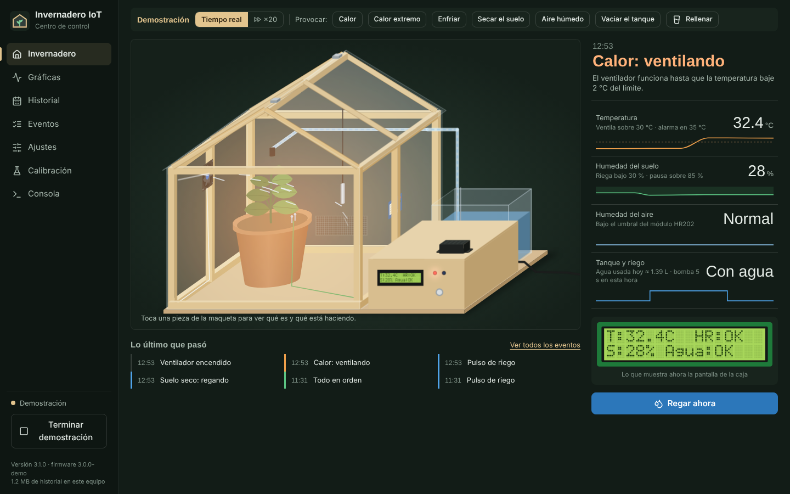
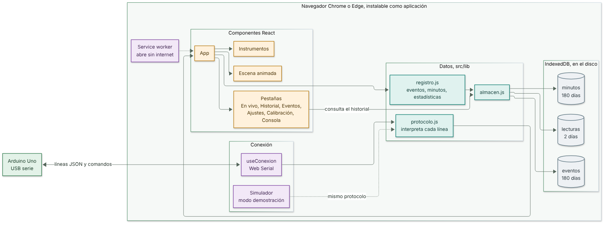

# Aplicación de monitoreo

Aplicación web en React 19 que se conecta al Arduino por USB con Web Serial. Complementa al firmware: el Arduino solo mide, decide y envía una línea JSON cada 2 s; la aplicación guarda el historial, calcula estadísticas y contiene la ayuda de los comandos, de modo que nada de eso ocupa la RAM del Arduino.



## Uso

`dist/` contiene la aplicación construida. Se abre `dist/index.html` en Chrome o Edge (versión 89 o posterior), o se usa la versión publicada en [https://maiwxzs.github.io/greenhouse-iot-firmware/](https://maiwxzs.github.io/greenhouse-iot-firmware/), que el flujo `.github/workflows/pages.yml` construye y publica en cada cambio de `app/`. Servida por HTTP o HTTPS se puede instalar como aplicación de escritorio y abre sin internet gracias a su service worker.

## Arquitectura



```
src/
├── main.jsx               Punto de entrada; registra el service worker
├── App.jsx                Estado global, conexión, registro y pestañas
├── estilos.css            Paleta, tipografía y animaciones
├── hooks/
│   ├── useConexion.js     Web Serial (lectura por líneas, escritura de comandos) y modo demostración
│   └── useInstalar.js     Instalación como aplicación (PWA)
├── lib/
│   ├── protocolo.js       Interpreta cada línea, textos de los estados, lista de comandos
│   ├── registro.js        Ventana en vivo, eventos, resumen por minuto y por día
│   ├── almacen.js         IndexedDB: lecturas, minutos y eventos, con retención
│   └── simulador.js       Simulador del Arduino con el mismo protocolo
└── componentes/
    ├── Escena.jsx         Invernadero animado con SVG
    ├── PanelEstado.jsx    Estado general, hora y acciones rápidas
    ├── Instrumentos.jsx   Indicadores de temperatura, suelo, aire y tanque
    ├── Grafica.jsx        Gráficas de tiempo (d3-scale y d3-shape) y franjas de actuadores
    ├── EnVivo.jsx, Historial.jsx, Eventos.jsx
    └── Ajustes.jsx, Calibracion.jsx, Consola.jsx
```

### Flujo de datos

1. `useConexion` lee el puerto, separa las líneas y las entrega a `protocolo.interpretarLinea`.
2. Cada `tel` actualiza la vista y pasa por `Registro`, que compara con la lectura anterior para generar eventos (riego, ventilador, aire húmedo, alarma, tanque, sensor) y acumula el minuto en curso.
3. `Registro` mantiene en memoria solo los últimos 30 minutos para las gráficas en vivo. Escribe en IndexedDB en lotes de 15 lecturas y un resumen al cerrar cada minuto.
4. `Almacen` borra al abrir lo que supera la retención.

### Almacenamiento

| Almacén de IndexedDB | Contenido | Retención |
|---|---|---|
| `lecturas` | Cada telemetría (2 s) | 2 días |
| `minutos` | Promedio, mínimo y máximo de temperatura y suelo; fracción de tiempo de bomba, ventilador, aire húmedo y alarma | 180 días |
| `eventos` | Estados, riegos, ventilador, aire, alarmas, comandos y conexiones | 180 días |

Los datos reales se guardan en la base `invernadero` y los de la demostración en `invernadero-demo`. Un día completo ocupa del orden de 10 MB entre lecturas y minutos.

### Animaciones

Cada animación de la escena representa un dato real: el ventilador gira con inercia cuando el relé 2 está activo; el agua corre por la manguera y caen gotas cuando la bomba funciona; las hojas se marchitan con el suelo seco y la tierra se oscurece con la humedad; el nivel del tanque baja; el termómetro sigue a la temperatura; el cielo cambia con la hora del invernadero; y el zumbador emite ondas cuando la alarma suena. Con «reducir movimiento» activado en el sistema operativo, las animaciones se desactivan.

## Desarrollo

```bash
cd app
npm install
npm run dev      # compila, observa cambios y sirve en http://localhost:8000
npm run build    # genera dist/ minificado
```

La construcción usa esbuild y produce un único `assets/app.js` en formato IIFE, que funciona también abierto como archivo local. La huella de la compilación se inserta en `index.html` y en `sw.js` para renovar la caché en cada versión.

| Dependencia | Uso |
|---|---|
| react, react-dom | Interfaz |
| d3-scale, d3-shape, d3-interpolate | Escalas y trazos de las gráficas, colores de la escena |
| react-icons | Íconos Lucide |
| esbuild | Construcción |
