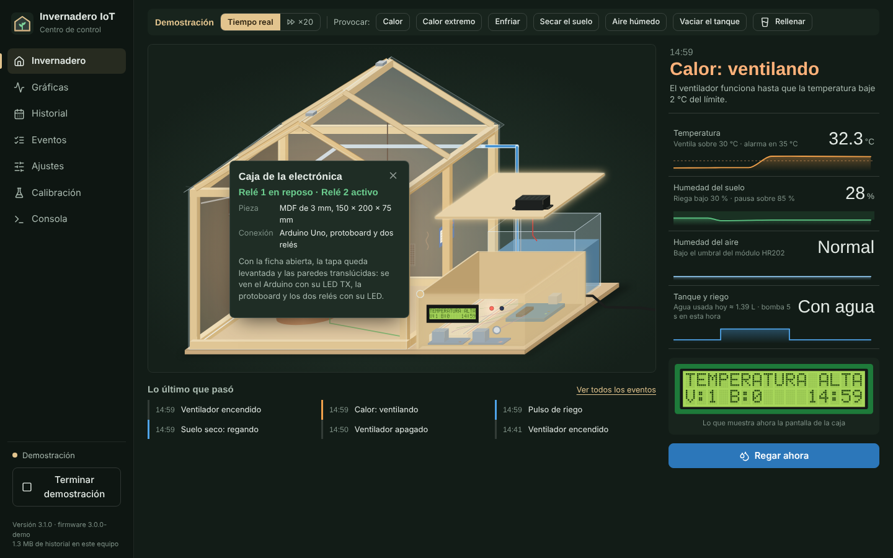

# Aplicación de escritorio

**Invernadero IoT** es la aplicación de Windows que acompaña al firmware. Se conecta al Arduino por USB, dibuja la maqueta con los datos en vivo y guarda el historial en el equipo. El Arduino solo mide, decide y envía una línea JSON cada 2 s; las gráficas, las estadísticas, la ayuda de los comandos y el historial viven en la aplicación, de modo que no ocupan la RAM del Arduino.


## Instalación

| Requisito | Valor |
|---|---|
| Sistema | Windows 10 u 11 de 64 bits |
| Espacio | Unos 300 MB instalada, más el historial (del orden de 10 MB por día de datos) |
| Controlador | CH340 si el Arduino es un clon; los originales no lo necesitan |

El instalador `Invernadero-IoT-<versión>-Windows.exe` está en la sección [Releases](https://github.com/maiwxzs/greenhouse-iot-firmware/releases) del repositorio. Deja un acceso directo en el escritorio y en el menú Inicio, y se desinstala desde **Configuración → Aplicaciones**. El instalador no está firmado digitalmente: Windows SmartScreen pide confirmación la primera vez (**Más información → Ejecutar de todas formas**).

## Pantallas

| Sección | Contenido |
|---|---|
| Invernadero | Maqueta interactiva, tablero de lecturas con trazas de 30 min, réplica de la pantalla LCD, acciones y bitácora |
| Gráficas | Temperatura y humedad del suelo de los últimos 30 min, y franjas de bomba, ventilador y aire húmedo |
| Historial | Hoy, 7 o 30 días: estadísticas, gráficas por minuto, resumen diario y exportación a CSV |
| Eventos | Cambios de estado, riegos, ventilador, aire húmedo, alarmas, comandos y conexiones |
| Ajustes | Umbrales de temperatura y suelo, y puesta en hora del reloj del invernadero |
| Calibración | Sonda de suelo y sonda del tanque, con la lectura cruda en vivo |
| Consola | Comandos escritos a mano y todas las líneas que envía el Arduino |

## Maqueta interactiva

La maqueta se dibuja en proyección oblicua con las medidas de [`docs/maqueta.md`](../docs/maqueta.md): base de 470 × 310 mm, invernadero de balso y acrílico, caja de MDF con la electrónica y tanque de 1 L. Cada animación corresponde a un dato de la telemetría:

| En la maqueta | Dato |
|---|---|
| El ventilador acelera y frena con inercia, con desenfoque de movimiento; el aire entra por la rejilla del fondo, rodea la planta y sale por el ventilador | `ventilador` |
| La manguera se llena desde la bomba hasta la boquilla; luego la corriente avanza por ella, caen gotas con gravedad que rebotan en las hojas y salpican la tierra, que se oscurece donde cae el agua; la bomba vibra y burbujea | `bomba` |
| Cada hoja es un resorte amortiguado: se marchita y amarillea con el suelo seco, se levanta al regar, se sacude con las gotas y tiembla con el viento del ventilador; el tallo se inclina hacia el ventilador | `hum_suelo`, `bomba`, `ventilador` |
| El agua del tanque tiene nivel y superficie propios: al rellenarlo cae un chorro con burbujas, el nivel sube con caudal limitado y la superficie se mueve con olas que rebotan en las paredes (ecuación de onda); mientras tanto la caja se vuelve translúcida para dejar ver el tanque | `_tanque`, `agua` |
| El aire del invernadero se tiñe de naranja y suben ondas de calor desde el piso | `temp_c` |
| Rocío en el acrílico, una niebla tenue que arrastra el ventilador y el LED del módulo HR202 | `aire_alta` |
| LED rojo fijo con el suelo seco e intermitente con el tanque vacío; LED azul con el aire húmedo | `suelo`, `agua`, `aire_alta` |
| El zumbador emite ondas y el marco de la maqueta pulsa en rojo | `alarma` |
| La pantalla de la caja escribe sus dos páginas | Todos los campos, igual que el firmware |
| La luz de la habitación sigue la hora del invernadero | `hora` |
| Puntos amarillos viajan por el cable USB hacia el computador con cada lectura; puntos celestes viajan hacia la caja con cada comando | Comunicación serie |

Las lecturas llegan cada 2 s, pero la escena no salta: temperatura, humedad y nivel se suavizan y los números del tablero se deslizan hasta su nuevo valor. El motor de animación (`escena/motor.js`) corre en un único `requestAnimationFrame`, usa conjuntos fijos de elementos SVG para las partículas y un paso fijo de 1/240 s para el agua, y modifica el SVG directamente sin volver a renderizar React. Toma alrededor de 1 ms por cuadro, así que la escena se mantiene a 60 cuadros por segundo con todo activo.

Cada pieza se puede tocar. Su ficha dice qué es, cómo está conectada y qué está haciendo, y ofrece la acción que le corresponde: regar desde la bomba, silenciar desde el zumbador o rellenar el tanque en la demostración. Al tocar la caja, la tapa se levanta y las paredes se vuelven translúcidas para mostrar el Arduino, la protoboard y los dos relés, con el LED TX que destella en cada lectura y el LED de cada relé. Con «reducir movimiento» activado en Windows, las animaciones continuas se desactivan.



## Arquitectura


```
app/
├── electron/
│   ├── main.cjs            Ventana, permisos y elección del puerto serie
│   └── preload.cjs         Puente mínimo con la interfaz (solo el puerto)
├── src/
│   ├── main.jsx            Punto de entrada
│   ├── App.jsx             Estado global, conexión, registro y navegación
│   ├── estilos.css         Tema oscuro con base verde y colores de los datos
│   ├── escena/
│   │   ├── proyeccion.js   Proyección oblicua en mm y planos de dibujo de cada cara
│   │   ├── geometria.js    Medidas de la maqueta compartidas por el dibujo y el motor
│   │   ├── Escena.jsx      Maqueta: invernadero, tanque y caja
│   │   ├── motor.js        Motor de animación: agua, riego, planta, ventilador, partículas
│   │   ├── Lcd.jsx         Réplica de la LCD 16x2 con matriz de puntos de 5x8
│   │   └── piezas.js       Ficha de cada pieza
│   ├── hooks/useConexion.js   Web Serial (lectura por líneas, escritura de comandos) y demostración
│   ├── lib/
│   │   ├── protocolo.js    Interpreta cada línea, textos de los estados, lista de comandos
│   │   ├── registro.js     Ventana en vivo, eventos, resumen por minuto y por día
│   │   ├── almacen.js      IndexedDB: lecturas, minutos y eventos, con retención
│   │   └── simulador.js    Arduino simulado con el mismo protocolo
│   └── componentes/        Inicio, Gráficas, Historial, Eventos, Ajustes, Calibración, Consola, SelectorPuerto
├── public/                 Íconos
├── recursos/icon.png       Ícono del instalador
└── build.mjs               Construcción de la interfaz con esbuild
```

### Conexión con el Arduino

La interfaz usa la API Web Serial de Chromium a 9600 baudios. Electron no trae el diálogo de puertos del navegador, así que el proceso principal escucha `select-serial-port`, envía la lista de puertos a la interfaz por el puente `window.escritorio` y espera la respuesta. El componente `SelectorPuerto` muestra la lista, preselecciona el puerto con identificador de Arduino (0x2341 o 0x2A03), CH340 (0x1A86), FTDI (0x0403) o CP210x (0x10C4) y se actualiza si se conecta o desconecta un dispositivo mientras está abierto. El proceso principal solo concede el permiso de puertos serie; cualquier otro permiso se rechaza.

### Flujo de datos

1. `useConexion` lee el puerto, separa las líneas y las entrega a `protocolo.interpretarLinea`.
2. Cada `tel` actualiza la vista y pasa por `Registro`, que la compara con la lectura anterior para generar eventos y acumula el minuto en curso.
3. `Registro` mantiene en memoria solo los últimos 30 minutos para las trazas y las gráficas en vivo. Escribe en IndexedDB en lotes de 15 lecturas y un resumen al cerrar cada minuto.
4. `Almacen` borra lo que supera la retención.

Las animaciones continuas corren en el motor de animación descrito arriba, fuera del ciclo de React.

Las gráficas dibujan su trazo de izquierda a derecha al cambiar de periodo, con relleno degradado bajo cada serie, un halo que late en el último valor y un cursor que marca cada serie con su valor exacto.

### Almacenamiento

| Almacén de IndexedDB | Contenido | Retención |
|---|---|---|
| `lecturas` | Cada telemetría (2 s) | 2 días |
| `minutos` | Promedio, mínimo y máximo de temperatura y suelo; fracción de tiempo de bomba, ventilador, aire húmedo y alarma | 180 días |
| `eventos` | Estados, riegos, ventilador, aire, alarmas, comandos y conexiones | 180 días |

Los datos reales se guardan en la base `invernadero` y los de la demostración en `invernadero-demo`, dentro de la carpeta de datos de la aplicación en el perfil del usuario de Windows.

### Seguridad

La ventana carga solo los archivos locales de `dist/`, con aislamiento de contexto, sin integración de Node en la interfaz, con el proceso de la interfaz en sandbox y una política de seguridad de contenido que no admite scripts externos. No navega a otros sitios y la aplicación no se conecta a internet.

## Desarrollo

```bash
cd app
npm install
npm start            # construye la interfaz y abre la aplicación
npm run dev          # interfaz en http://localhost:8000 con recarga (Chrome o Edge)
npm run instalador   # genera release/Invernadero-IoT-<versión>-Windows.exe
```

GitHub Actions (`.github/workflows/aplicacion.yml`) construye el instalador en Windows en cada cambio de `app/`, abre la aplicación empaquetada en modo de prueba (`--prueba`) para comprobar que la interfaz y la maqueta cargan, y deja el `.exe` como artefacto. Al publicar una etiqueta `vX.Y.Z`, adjunta el instalador a una versión en Releases.

| Dependencia | Uso |
|---|---|
| electron | Ventana de escritorio y acceso al puerto serie |
| electron-builder | Instalador NSIS para Windows |
| react, react-dom | Interfaz |
| d3-scale, d3-shape, d3-interpolate | Escalas y trazos de las gráficas, colores de la maqueta |
| react-icons | Íconos Lucide |
| esbuild | Construcción de la interfaz |
