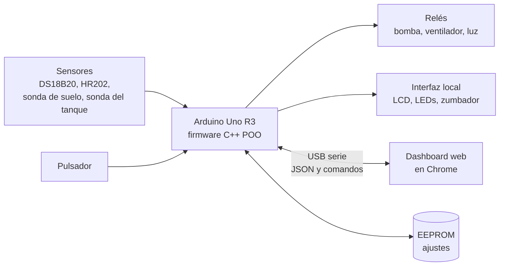
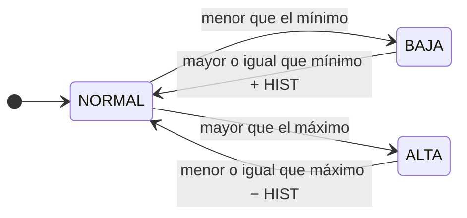

# Especificación técnica

**Proyecto:** Smart Greenhouse IoT, invernadero automatizado con Arduino
**Versión del firmware:** 2.0.0
**Plataforma:** Arduino Uno R3 (ATmega328P, 5 V, 2 KB de RAM, 32 KB de flash)

## 1. Problema

Los cultivos pequeños en invernadero pierden producción por cambios de temperatura y humedad que nadie detecta a tiempo. Sin un operador presente, la ventilación y el riego llegan tarde, cuando la planta ya sufrió estrés térmico o hídrico, y tampoco hay una señal visible en el sitio que diga si las condiciones son buenas o malas.

## 2. Objetivo

Construir un sistema embebido que:

1. Mida de forma continua la temperatura, la humedad del aire, la humedad del suelo y el nivel de agua del tanque.
2. Decida por sí solo cuándo ventilar, regar o encender la luz, con reglas configurables.
3. Avise en el sitio (pantalla, LEDs y zumbador) y en el computador (dashboard web).
4. Registre los datos para analizarlos después (CSV).

## 3. Alcance

**Incluye:** firmware del Arduino, dashboard web por USB, maqueta física, documentación técnica y de usuario, simulación en Tinkercad y pruebas automáticas.

**No incluye:** conexión WiFi o a internet, servidor ni base de datos. El sistema funciona completo sin computador; el dashboard es opcional.

## 4. Requisitos

### Funcionales

| ID | Requisito | Cómo se cumple |
|---|---|---|
| RF-01 | Medir temperatura cada 2 s con precisión de ±0.5 °C | DS18B20 a 12 bits, lectura no bloqueante |
| RF-02 | Medir humedad del aire | Módulo HR202, salida analógica calibrada en dos puntos |
| RF-03 | Medir humedad del suelo sin comprar un sensor | Sonda de dos clavos con el pull-up interno del Arduino |
| RF-04 | Detectar el tanque vacío | Sonda de dos cables en el tanque |
| RF-05 | Ventilar por calor o por humedad alta | Relé 2 y ventilador, con histéresis |
| RF-06 | Regar por suelo seco o nebulizar por aire seco | Relé 1 y bomba, en pulsos de 5 s |
| RF-07 | No regar con el tanque vacío ni con el suelo encharcado | `ReglaControl::requiereRiego()` |
| RF-08 | Encender la luz de cultivo según un horario | Relé 3, reloj por software y comando `LUZ` |
| RF-09 | Indicar el estado en el sitio | LCD 16×2, LED rojo, LED azul y zumbador |
| RF-10 | Riego manual y silencio de la alarma | Pulsador: corto = riego, largo = silencio |
| RF-11 | Cambiar umbrales sin reprogramar | Comandos serie; ajustes guardados en EEPROM |
| RF-12 | Ver y exportar datos en el computador | Dashboard web (Web Serial) y descarga CSV |

### No funcionales

| ID | Requisito | Cómo se cumple |
|---|---|---|
| RNF-01 | Funcionar solo con el USB del Arduino (máx. 500 mA) | Una carga grande a la vez (sección 7) |
| RNF-02 | Respetar el ciclo de trabajo de la bomba (máx. 20 min/h) | Pausa mínima de 1 min y cupo de 15 min/h |
| RNF-03 | Caber en el Arduino Uno | 1448 B de RAM (70.7 %) y 29 KB de flash (90.1 %), medidos en CI |
| RNF-04 | Responder siempre, sin bloquearse | Sin `delay()` largos; el loop se repite cada pocos milisegundos |
| RNF-05 | Fallar de forma segura | Sección 8 |
| RNF-06 | Código mantenible y probado | POO según el UML, lógica separada en `Logica.h`, 25 pruebas unitarias |

## 5. Arquitectura

Diagramas detallados (fuente Mermaid, SVG, PNG y draw.io) en [`docs/diagramas/`](diagramas/):
arquitectura del sistema, bloques del firmware, flujo de control, diagrama de clases UML, estados de humedad y secuencia del dashboard.

### Organización del firmware

| Archivo | Contenido | Depende de Arduino |
|---|---|---|
| `firmware/include/Config.h` | Pines, partes instaladas, valores de fábrica, tiempos | Sí |
| `firmware/include/Logica.h` | `LecturaDato`, `Ajustes`, `ReglaControl`, `CicloTrabajoBomba`, `repartirEnergia`, `RelojSoftware`, `parsearComando` | **No** (se prueba en el computador) |
| `firmware/include/GreenhouseCore.hpp` | Sensores, actuadores, pantalla, pulsador, EEPROM, controlador e invernadero | Sí |
| `firmware/src/main.cpp` | Crea los objetos y llama a `setup()` / `loop()` | Sí |
| `firmware/test/test_logica/` | Pruebas unitarias de `Logica.h` | No |

Separar la lógica del hardware permite probar todas las decisiones (histéresis, riego, energía, reloj, comandos) sin el Arduino conectado.

## 6. Lógica de control

Cada 2 segundos el controlador lee los sensores y `ReglaControl` decide:

| Situación | Bomba | Ventilador | LED rojo | LED azul | Zumbador |
|---|---|---|---|---|---|
| Temperatura > `TEMP` (deja de ventilar 2 °C por debajo) | — | ON | — | — | — |
| Temperatura ≥ `TEMPCRIT` | — | ON | — | — | Alarma |
| Suelo < `SUELOMIN` | Pulsos | — | ON | — | — |
| Aire < `HUMMIN` y suelo no encharcado | Pulsos | — | ON | — | — |
| Suelo > `SUELOMAX` | Bloqueada | — | — | — | — |
| Aire > `HUMMAX` | — | ON | — | ON | — |
| Tanque vacío | Bloqueada | — | Parpadea | — | Alarma |
| DS18B20 desconectado | — | ON (seguridad) | Alternan | Alternan | Alarma |

### Histéresis

Para entrar en BAJA o ALTA basta cruzar el umbral; para volver a NORMAL hay que alejarse `HIST` puntos. Así los relés no se encienden y apagan a cada rato cuando el valor está justo en el límite.

### Riego por pulsos

La bomba riega 5 s y espera al menos 1 min antes del siguiente pulso, para que el agua se reparta y el sensor lo note. Además, nunca suma más de 15 min por hora (el fabricante permite 20). Con los valores de fábrica trabaja como máximo unos 4.6 min por hora. El riego manual se salta la pausa, pero respeta el cupo y el tanque.

### Luz de cultivo

Un reloj por software (basado en `millis()`) lleva la hora del día. Arranca a las 08:00 y se pone en hora con el comando `HORA` o, automáticamente, al conectar el dashboard. Sin módulo RTC el reloj puede desviarse unos minutos por día y se reinicia si se corta la energía.

## 7. Energía

Todo se alimenta del USB del Arduino, que entrega como máximo 500 mA. Para no superarlo, con `ALIMENTACION_SOLO_ARDUINO = true` solo una carga grande funciona a la vez, con prioridad **bomba > ventilador > luz**. El reparto se recalcula en cada vuelta del loop, así que nunca coinciden dos cargas.

| Consumo aproximado | mA |
|---|---|
| Arduino Uno | 50 |
| Una bobina de relé | 70 |
| Bomba sumergible (este modelo: 130–220 mA a 5 V) | 220 |
| 2 LEDs con 220 Ω | 30 |
| LCD con luz de fondo | 25 |
| Sensores | 10 |
| Zumbador (al pitar) | 30 |
| **Peor caso, con la bomba** | **≈ 435** |

Si el Arduino se reinicia al arrancar la bomba (en el monitor serie vuelve a aparecer el mensaje de inicio), se alimentan las cargas con un cargador de 5 V aparte y se pone `ALIMENTACION_SOLO_ARDUINO = false`.

## 8. Fallas y respuesta segura

| Falla | Cómo se detecta | Respuesta del sistema |
|---|---|---|
| DS18B20 desconectado | Lee −127 °C o fuera de −55…125 °C | Ventilador encendido, LEDs alternados, alarma |
| Sonda de suelo al aire o cable suelto | Lectura ≥ 1015 | Se ignora el suelo y se decide por la humedad del aire |
| Tanque vacío | Sonda del tanque al aire | Bomba bloqueada, LED rojo parpadea, alarma |
| Bomba trabajando de más | Contador de tiempo por hora | Se detiene al llegar a 15 min/h |
| EEPROM vacía o dañada | Firma, versión, checksum y rangos | Carga los valores de fábrica |
| Arduino se reinicia | — | Los relés arrancan apagados (sin clic) y los ajustes se recuperan de la EEPROM |
| Pantalla no conectada | No responde en 0x27 ni 0x3F | El sistema sigue sin pantalla |
| Comando inválido | Validación antes de aplicar | Responde con un error y no cambia nada |
| Desbordamiento de `millis()` (cada 49.7 días) | Restas sin signo | Los tiempos siguen funcionando |

## 9. Pruebas

| Nivel | Qué cubre | Cómo se ejecuta |
|---|---|---|
| Unitarias (25) | Histéresis, reglas de riego y ventilación, ciclo de la bomba, reparto de energía, reloj, comandos, validación de ajustes | `cd firmware && pio test -e native` |
| Compilación | Firmware para Arduino Uno, con y sin LCD, y uso de memoria | GitHub Actions en cada cambio (`.github/workflows/firmware.yml`) |
| Simulación | Circuito completo con piezas equivalentes | Tinkercad ([guía](tinkercad.md)) |
| Integración en el banco | Cada sensor y actuador con el circuito real | Tabla de pruebas del [manual de usuario](manual-usuario.md#probar-cada-parte) |

## 10. Limitaciones conocidas

- **HR202:** no viene calibrado de fábrica; el porcentaje es una aproximación entre dos puntos de calibración.
- **Sondas caseras:** se corroen con el tiempo, aunque solo se energizan durante la medición. Conviene limpiarlas o cambiar los clavos cada pocas semanas.
- **Reloj:** sin módulo RTC puede desviarse unos minutos por día.
- **Memoria flash:** el firmware usa el 90 % de la flash. Para agregar funciones grandes conviene desactivar la LCD (`USAR_LCD 0`, que libera unos 4.7 KB) o pasar a un Arduino Mega.

## 11. Posibles mejoras

- Módulo RTC DS3231 para que el reloj no se desvíe ni se pierda.
- Sensor capacitivo de suelo, que no se corroe.
- Tarjeta microSD para guardar datos sin computador.
- Placa con WiFi para ver los datos a distancia.
