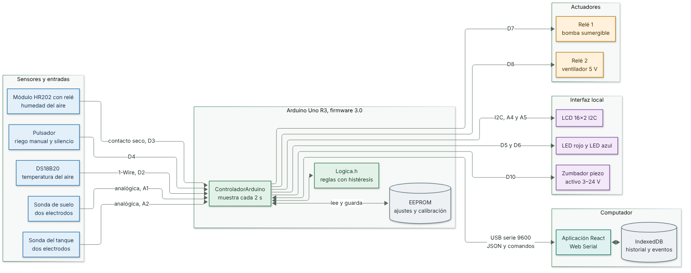
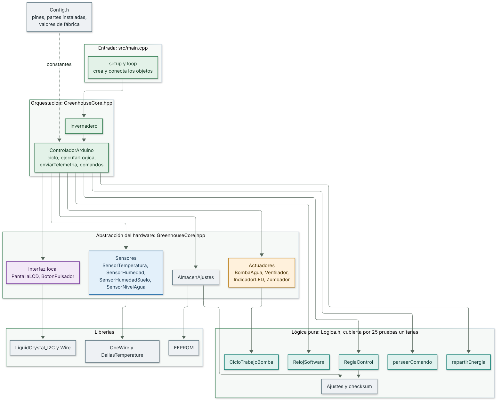
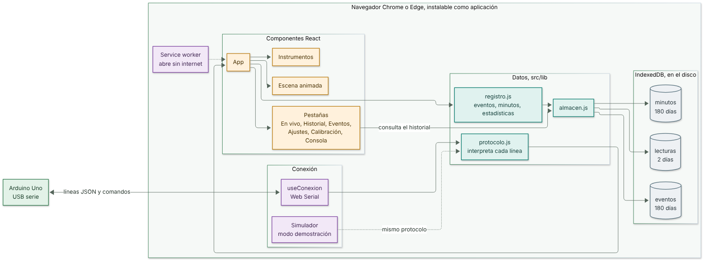
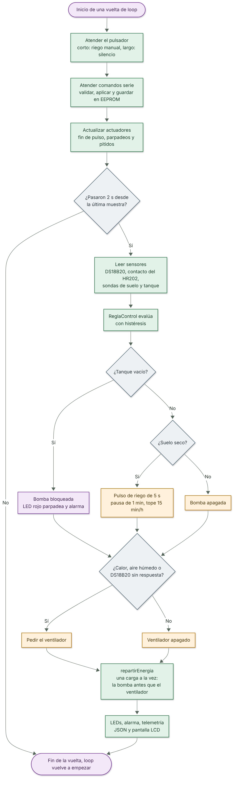
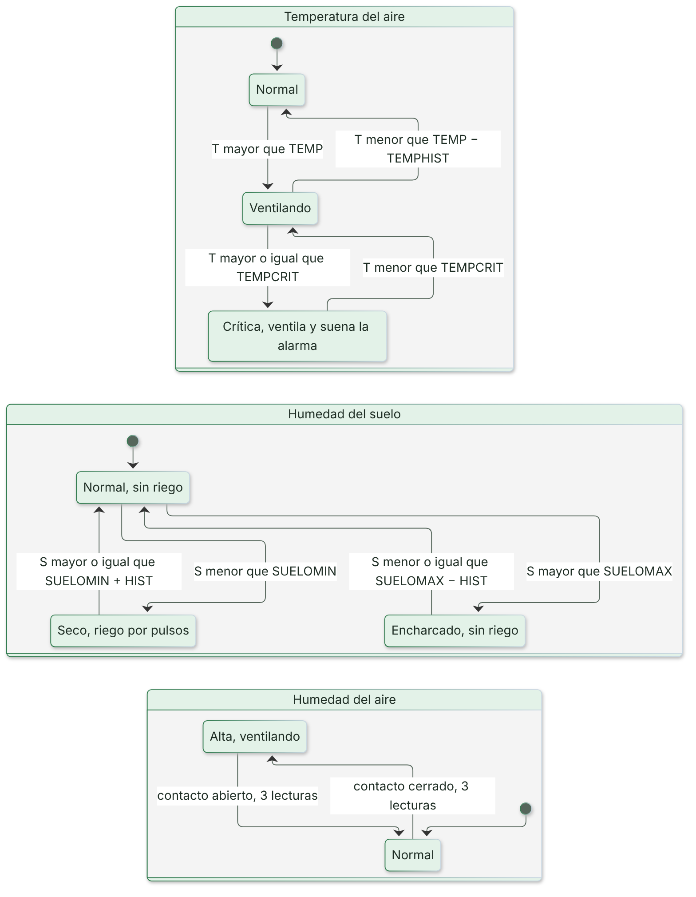

# Especificación técnica

| | |
|---|---|
| **Proyecto** | Smart Greenhouse IoT, invernadero automatizado a escala |
| **Firmware** | 3.0.0 |
| **Aplicación** | 3.0.0 |
| **Controlador** | Arduino Uno R3 (ATmega328P a 16 MHz, 5 V, 2 KB de RAM, 32 KB de flash, 1 KB de EEPROM) |
| **Alimentación** | USB del Arduino, 5 V y 500 mA como máximo |

## 1. Problema

En un cultivo pequeño bajo cubierta, la temperatura y la humedad cambian a lo largo del día más rápido de lo que una persona alcanza a vigilar. Cuando la ventilación o el riego llegan tarde, la planta ya sufrió estrés térmico o hídrico. Además, sin una indicación en el sitio, nadie sabe a simple vista si las condiciones son buenas.

## 2. Objetivo

Un sistema embebido de bajo costo que:

1. Mide de forma continua la temperatura del aire, la humedad del aire, la humedad del suelo y el nivel del tanque.
2. Decide por sí solo cuándo ventilar y cuándo regar, con reglas configurables.
3. Informa en el sitio con pantalla, LEDs y zumbador, y en el computador con una aplicación de monitoreo.
4. Conserva un historial de lecturas y eventos para analizar el comportamiento del cultivo.

## 3. Alcance

**Incluye:** firmware del Arduino, aplicación de monitoreo por USB, maqueta física, simulación en Tinkercad, pruebas automáticas y documentación técnica y de usuario.

**No incluye:** conexión inalámbrica, servidor ni acceso remoto. El invernadero funciona completo sin computador; la aplicación agrega visualización, historial y configuración.

## 4. Requisitos

### Funcionales

| ID | Requisito | Implementación |
|---|---|---|
| RF-01 | Medir la temperatura cada 2 s con ±0.5 °C | DS18B20 a 12 bits, conversión no bloqueante |
| RF-02 | Detectar humedad del aire alta | Contacto NO del módulo HR202, con antirrebote de 3 lecturas |
| RF-03 | Medir la humedad del suelo sin un sensor comercial | Sonda de dos clavos con el pull-up interno del Arduino |
| RF-04 | Detectar el tanque vacío | Sonda de dos cables en el tanque |
| RF-05 | Ventilar por calor o por aire húmedo | Relé 2 y ventilador, con histéresis de temperatura |
| RF-06 | Regar cuando el suelo está seco | Relé 1 y bomba, en pulsos de 5 s |
| RF-07 | No regar con el tanque vacío ni con el suelo encharcado | `ReglaControl::requiereRiego()` |
| RF-08 | Indicar el estado en el sitio | LCD 16×2, LED rojo, LED azul y zumbador |
| RF-09 | Riego manual y silencio de la alarma | Pulsador: corto riega o silencia, largo silencia |
| RF-10 | Cambiar los umbrales sin reprogramar | Comandos serie; ajustes en EEPROM con validación y checksum |
| RF-11 | Ver, guardar y exportar datos en el computador | Aplicación React con Web Serial, IndexedDB y exportación CSV |

### No funcionales

| ID | Requisito | Implementación |
|---|---|---|
| RNF-01 | Funcionar solo con el USB del Arduino | Una carga grande a la vez (sección 7) |
| RNF-02 | Respetar el ciclo de trabajo de la bomba (máx. 20 min/h) | Pausa mínima de 1 min y tope de 15 min/h |
| RNF-03 | Caber en el Arduino Uno | RAM 65.5 % y flash 79.1 %, medidos en cada compilación; textos en flash y sin STL |
| RNF-04 | No bloquearse | Sin `delay()` largos; cada vuelta de `loop()` dura milisegundos |
| RNF-05 | Fallar de forma segura | Sección 8 |
| RNF-06 | Código mantenible y verificable | POO según el UML, lógica separada en `Logica.h`, 25 pruebas unitarias |
| RNF-07 | No cargar la RAM del Arduino con historial | El historial, las estadísticas y los textos de ayuda viven en la aplicación |

## 5. Arquitectura

### Firmware

| Archivo | Contenido | Depende de Arduino |
|---|---|---|
| `firmware/include/Config.h` | Pines, partes instaladas, valores de fábrica y tiempos | Sí |
| `firmware/include/Logica.h` | `LecturaDato`, `Ajustes`, `ReglaControl`, `CicloTrabajoBomba`, `repartirEnergia`, `RelojSoftware`, `parsearComando` | **No** |
| `firmware/include/GreenhouseCore.hpp` | Sensores, actuadores, pantalla, pulsador, EEPROM, controlador e invernadero | Sí |
| `firmware/src/main.cpp` | Crea los objetos y los conecta | Sí |
| `firmware/test/test_logica/` | Pruebas unitarias de `Logica.h` | No |

Todas las decisiones (histéresis, riego, reparto de energía, reloj, interpretación de comandos y validación de ajustes) están en `Logica.h`, sin acceso a pines. Por eso se prueban en el computador con `pio test -e native`. El diagrama de clases completo está en [`diagramas/uml-clases.png`](diagramas/uml-clases.png).

### Aplicación

La aplicación recibe cada línea JSON del Arduino, la interpreta, detecta eventos y la acumula por minuto. Escribe en IndexedDB en lotes de 15 lecturas para no tocar el disco cada 2 s. El detalle está en [`app/README.md`](../app/README.md).

## 6. Control

Cada 2 s el controlador lee los sensores y `ReglaControl` evalúa:

| Situación | Bomba | Ventilador | LED rojo | LED azul | Zumbador |
|---|---|---|---|---|---|
| Temperatura > `TEMP` | — | Encendido | — | — | — |
| Temperatura ≥ `TEMPCRIT` | — | Encendido | — | — | Alarma |
| Contacto del HR202 cerrado | — | Encendido | — | Encendido | — |
| Suelo < `SUELOMIN` | Pulsos | — | Encendido | — | — |
| Suelo > `SUELOMAX` | Bloqueada | — | — | — | — |
| Tanque vacío | Bloqueada | — | Intermitente | — | Alarma |
| DS18B20 sin respuesta | — | Encendido | Alterna | Alterna | Alarma |

### Histéresis

- **Temperatura:** ventila al superar `TEMP` y se detiene cuando baja de `TEMP − TEMPHIST`.
- **Suelo:** pasa a seco por debajo de `SUELOMIN` y vuelve a normal al llegar a `SUELOMIN + HIST`. El encharcado es simétrico con `SUELOMAX`.
- **Aire:** el módulo HR202 compara la humedad con el umbral de su potenciómetro y cierra su relé. El firmware acepta un cambio solo cuando el contacto se repite en 3 lecturas seguidas (6 s), para descartar rebotes.

### Humedad del aire con el módulo HR202

El módulo no tiene salida de señal: su comparador LM393 activa un relé propio. El firmware lee ese relé como un contacto seco. COM va a GND y NO va a D3, configurado con `INPUT_PULLUP`. Contacto cerrado (D3 en bajo) significa humedad por encima del umbral. Por eso la humedad del aire es binaria (normal o alta) y el riego automático depende solo de la humedad del suelo.

### Riego por pulsos

La bomba riega 5 s y espera al menos 1 min antes del siguiente pulso, para que el agua se reparta y la sonda la detecte. No suma más de 15 min por hora; el fabricante admite 20. Con los valores de fábrica trabaja como máximo unos 4.6 min por hora. El riego manual se salta la pausa, pero respeta el tope horario y el tanque.

### Reloj

Un reloj por software basado en `millis()` lleva la hora del día. Arranca a las 08:00 y se sincroniza con el comando `HORA`, que la aplicación envía al conectarse. La hora se muestra en la LCD y viaja en la telemetría. Sin módulo RTC puede desviarse algunos minutos por día y se reinicia si se corta la energía.

## 7. Energía

Todo se alimenta del USB del Arduino. Con `ALIMENTACION_SOLO_ARDUINO = true` la bomba y el ventilador nunca funcionan a la vez: la bomba tiene prioridad y el ventilador se pausa durante el pulso de riego. El reparto se recalcula en cada vuelta del `loop()`.

| Consumo | mA |
|---|---|
| Arduino Uno | 50 |
| Bobina de un módulo relé | 70 |
| Bomba sumergible (130–220 mA a 5 V) | 220 |
| Ventilador 40 × 40 mm | 100 |
| Relé y LEDs del módulo HR202, con el aire húmedo | 80 |
| LCD con luz de fondo | 25 |
| LED rojo y LED azul con 220 Ω | 27 |
| Zumbador piezoeléctrico | 12 |
| DS18B20 y sondas | 10 |
| **Peor caso: bomba, aire húmedo, alarma y LEDs a la vez** | **≈ 495** |

El peor caso dura lo que un pulso de riego (5 s) y queda por debajo de los 500 mA del puerto. El fusible reajustable del Arduino corta a partir de 1 A.

## 8. Fallas y respuesta segura

| Falla | Detección | Respuesta |
|---|---|---|
| DS18B20 desconectado | −127 °C o fuera de −55…125 °C | Ventilador encendido, LEDs alternados, alarma |
| Sonda de suelo al aire o cable suelto | Lectura ≥ 1015 | Se ignora el suelo y no hay riego automático |
| Tanque vacío | Sonda del tanque al aire | Bomba bloqueada, LED rojo intermitente, alarma |
| Bomba trabajando de más | Tiempo acumulado por hora | Se detiene al llegar a 15 min/h |
| EEPROM vacía o dañada | Firma, versión, checksum y rangos | Valores de fábrica |
| Reinicio del Arduino | — | Los relés arrancan apagados, sin clic; los ajustes vuelven de la EEPROM |
| Pantalla ausente | Sin respuesta en 0x27 ni 0x3F | El sistema sigue sin pantalla |
| Comando inválido | Validación antes de aplicar | Respuesta de error, sin cambios |
| Desbordamiento de `millis()` (cada 49.7 días) | Restas sin signo | Los tiempos siguen siendo correctos |

## 9. Verificación

| Nivel | Cobertura | Ejecución |
|---|---|---|
| Unitarias (25) | Histéresis, riego, ventilación, ciclo de la bomba, reparto de energía, reloj, comandos y validación de ajustes | `cd firmware && pio test -e native` |
| Compilación | Firmware para el Uno con y sin LCD, uso de memoria y construcción de la aplicación | GitHub Actions en cada cambio |
| Simulación | Circuito completo con piezas equivalentes | Tinkercad ([documentación](tinkercad.md)) |
| Aplicación | Modo demostración con el mismo protocolo del firmware | `app/dist/index.html` |
| Banco | Cada sensor y actuador con el circuito real | Tabla de pruebas del [manual de usuario](manual-usuario.md#pruebas-de-funcionamiento) |

## 10. Limitaciones

- **Humedad del aire:** el módulo HR202 entrega solo «sobre el umbral» o «bajo el umbral». No hay porcentaje, y el umbral se ajusta a mano con su potenciómetro.
- **Sondas caseras:** se oxidan con el tiempo, aunque solo se energizan durante la medición. Los clavos se limpian o se cambian cada pocas semanas.
- **Reloj:** sin RTC puede desviarse algunos minutos por día; la aplicación lo corrige al conectarse.
- **Alimentación:** con solo USB, la bomba y el ventilador no funcionan a la vez.
- **Memoria:** quedan unos 700 bytes de RAM y 6.7 KB de flash. Para funciones grandes se puede compilar sin LCD (`USAR_LCD 0`, que libera 4.5 KB de flash) o migrar a un Arduino Mega.

## 11. Mejoras posibles

- Módulo RTC DS3231 para conservar la hora.
- Sensor capacitivo de humedad del suelo, que no se oxida.
- Sensor de humedad del aire con salida en porcentaje, como el SHT31.
- Fuente de 5 V independiente para las cargas, para ventilar y regar a la vez.
