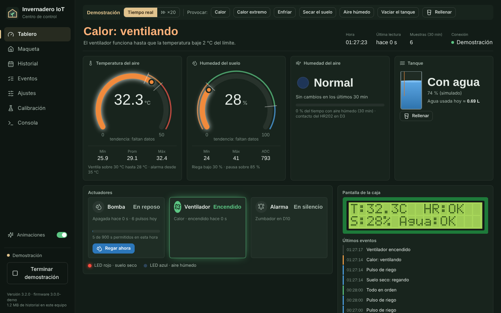
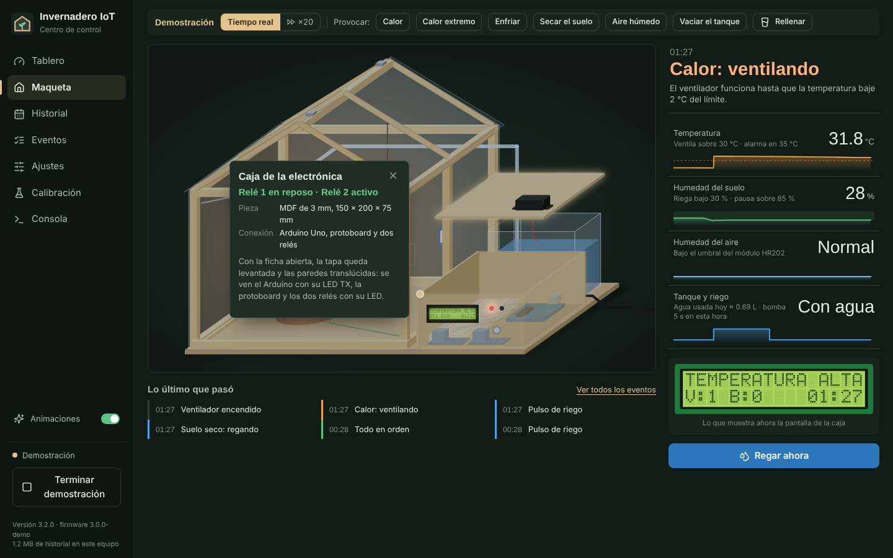
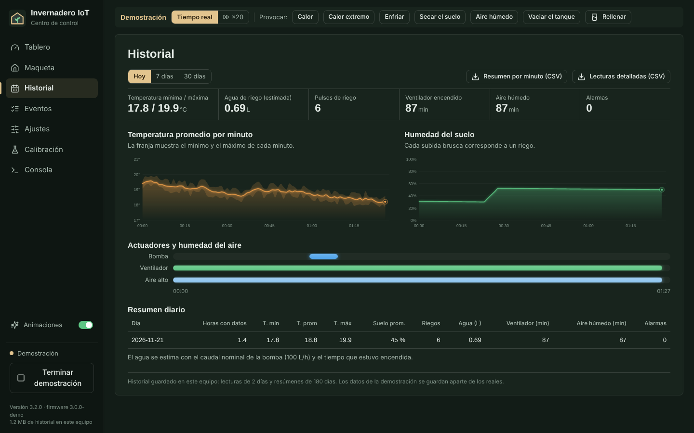

# Manual de usuario

## Puesta en marcha

Con el tanque lleno y la bomba sumergida, el invernadero se enciende al conectar el cable USB del Arduino a un computador o a un cargador de celular de 5 V y 1 A. Al arrancar:

- el zumbador da un pitido corto;
- la pantalla muestra «Invernadero IoT» y la versión del firmware;
- a los 2 s aparecen las primeras lecturas, y el LED de la placa (D13) parpadea en cada lectura.

El sistema trabaja solo. El computador se usa para ver gráficas e historial, cambiar ajustes y calibrar.

## Indicadores

### Pantalla

Alterna dos páginas cada 4 s.

| Página 1 | Página 2 |
|---|---|
| `T:24.5C  HR:OK`: temperatura y humedad del aire (`OK` o `ALTA`) | Estado general, por ejemplo `SUELO SECO` |
| `S:48% Agua:OK`: humedad del suelo y tanque | `V:0 B:1    14:30`: ventilador, bomba y hora |

`S:--` indica que la sonda de suelo está desactivada en `Config.h`, y `S:??` que no toca tierra o tiene un cable suelto.

### LEDs

| LED | Significado |
|---|---|
| Rojo encendido | Suelo seco: el sistema está regando |
| Rojo intermitente | Tanque vacío |
| Azul encendido | Aire húmedo: el sistema está ventilando |
| Rojo y azul alternando | El sensor de temperatura no responde |
| Ambos apagados | Condiciones normales |

El módulo HR202 tiene además su propio LED verde, que se enciende junto con el LED azul cuando la humedad supera su umbral.

### Zumbador

- **Un pitido corto:** arranque, o riego manual aceptado.
- **Dos pitidos:** riego manual rechazado porque el tanque está vacío.
- **Tres pitidos cada 30 s:** alarma por tanque vacío, temperatura crítica o sensor de temperatura sin respuesta.

## Pulsador

- **Pulsación corta:** un pulso de riego de 5 s, aunque la tierra no esté seca. No funciona con el tanque vacío.
- **Pulsación corta con la alarma sonando:** silencia la alarma 10 minutos.
- **Pulsación de 3 s:** silencia la alarma 10 minutos.

## Aplicación de escritorio

### Instalar

1. En la sección [Releases](https://github.com/maiwxzs/greenhouse-iot-firmware/releases) del repositorio se descarga `Invernadero-IoT-<versión>-Windows.exe`.
2. Al abrirlo, Windows SmartScreen puede mostrar «Windows protegió su PC», porque el instalador no tiene firma digital: **Más información → Ejecutar de todas formas**.
3. El instalador pregunta la carpeta y deja un acceso directo **Invernadero IoT** en el escritorio y en el menú Inicio.

Funciona en Windows 10 y 11 de 64 bits y no necesita internet. Si el Arduino es un clon con chip CH340, Windows necesita el controlador CH340 para reconocer el puerto.

### Conectar

**Conectar**, en la parte inferior del menú lateral, abre la lista de puertos USB y marca el del Arduino; en los clones suele llamarse «USB-SERIAL CH340». El Arduino se reinicia al abrir el puerto, así que las lecturas tardan unos segundos. Al conectarse, la aplicación pone en hora el reloj del invernadero. Solo un programa a la vez puede usar el puerto: si aparece ocupado, hay que cerrar el Monitor Serie del Arduino IDE.

**Demostración** inicia un Arduino simulado que habla el mismo protocolo. Corre a velocidad real o ×20, y una barra superior permite provocar calor, calor extremo, sequía, aire húmedo o tanque vacío, y rellenar el tanque, para ver cómo reacciona el control. Sus datos se guardan aparte de los reales.

### Tablero

La aplicación abre en el **Tablero**, pensado para dejarlo a la vista mientras el sistema trabaja. Arriba muestra el estado del invernadero, la hora, cuánto hace que llegó la última lectura y la conexión; si suena una alarma aparece una franja roja con su motivo y el botón para silenciarla. Debajo están los medidores de temperatura y humedad del suelo, con sus zonas (ventilar, alarma, riego), los mínimos y máximos de los últimos 30 minutos y la tendencia de los últimos 10, la humedad del aire y el tanque. La fila de actuadores dice si la bomba, el ventilador y la alarma están activos, por qué y desde hace cuánto, cuántos pulsos de riego van en el día y cuánto del cupo de 900 s por hora lleva la bomba. Al final están la réplica de la pantalla LCD, los últimos eventos y las gráficas de los últimos 30 minutos.

### La maqueta

La sección **Maqueta** muestra la maqueta tal como está construida, animada con las lecturas: gira el ventilador, corre el agua, cambian la tierra y las hojas, baja el tanque, aparece rocío con el aire húmedo y el zumbador emite ondas con la alarma. Cada lectura que llega viaja como un punto amarillo por el cable USB; cada comando, como un punto celeste en sentido contrario.

Las animaciones están activadas por defecto; el interruptor **Animaciones** del menú lateral las apaga si el equipo es muy lento o si prefieres una vista quieta.

Al tocar una pieza aparece su ficha: qué es, cómo está conectada, qué está haciendo y, cuando corresponde, un botón para actuar (regar, silenciar la alarma o rellenar el tanque en la demostración). Al tocar la caja se levanta la tapa y se ve el interior, con los LEDs de los relés y el LED TX del Arduino.

A la derecha, el tablero muestra el estado, las cuatro lecturas con su traza de los últimos 30 minutos y una réplica de la pantalla LCD de la caja. Debajo de la maqueta, la bitácora muestra lo último que pasó.

### Secciones

| Sección | Contenido |
|---|---|
| Tablero | Pantalla principal en tiempo real: estado y alarma, medidores de temperatura y humedad del suelo con mínimos, máximos y tendencia de 10 min, humedad del aire, tanque y agua usada, bomba, ventilador, alarma y LEDs con su tiempo en el estado actual, cupo de la bomba en la hora, réplica de la LCD, últimos eventos y gráficas de 30 min |
| Maqueta | Maqueta interactiva, lecturas, pantalla LCD, acciones y bitácora |
| Historial | Hoy, 7 días o 30 días: estadísticas, gráficas por minuto y resumen diario. Exportación a CSV |
| Eventos | Cambios de estado, riegos, ventilador, aire húmedo, alarmas, comandos y conexiones |
| Ajustes | Umbrales de temperatura y suelo, y botón para poner en hora el reloj |
| Calibración | Sonda de suelo y sonda del tanque, con la lectura cruda en vivo |
| Consola | Comandos escritos a mano y todas las líneas que envía el Arduino |

El historial se llena mientras la aplicación está conectada y se guarda en el equipo: las lecturas detalladas de los últimos 2 días y un resumen por minuto de los últimos 180 días. Los CSV usan punto y coma y coma decimal, el formato que espera Excel en español.

## Ajustes

Se cambian en la pestaña **Ajustes** o con comandos en la consola ([protocolo serie](protocolo-serie.md)). Quedan guardados en la EEPROM del Arduino.

| Para… | Comando |
|---|---|
| Ventilar desde 28 °C | `TEMP 28` |
| Activar la alarma desde 33 °C | `TEMPCRIT 33` |
| Regar cuando la tierra baje de 35 % | `SUELOMIN 35` |
| Poner la hora | `HORA 14:30` |
| Volver a los valores de fábrica | `FABRICA` |

El umbral de humedad del aire se ajusta con el potenciómetro azul del módulo HR202: en sentido horario el umbral sube. El momento en que el contacto se cierra se ve en el LED verde del módulo y en el LED azul del invernadero.

## Calibración

Cada sonda casera conduce distinto según la tierra, el agua y los electrodos, por eso se calibran una vez instaladas. La pestaña **Calibración** tiene un botón para cada punto.

| Punto | Condición | Comando |
|---|---|---|
| Suelo seco | Clavos en tierra seca | `CAL SUELOSECO` |
| Suelo húmedo | La misma tierra recién regada, tras un minuto | `CAL SUELOHUMEDO` |
| Tanque | Los dos cables de la sonda dentro del agua | `CAL TANQUE` |

Las lecturas crudas (0–1023) se ven en los campos `adc_suelo` y `adc_agua` de la consola.

## Pruebas de funcionamiento

| Prueba | Acción | Resultado esperado |
|---|---|---|
| Temperatura | Sostener la punta del DS18B20 en la mano, o enviar `TEMP 26` | La temperatura sube; sobre el límite arranca el ventilador |
| Humedad del aire | Exhalar sobre el sensor del HR202 | LED verde del módulo, LED azul y ventilador tras unos 6 s |
| Suelo seco | Sacar los clavos de la tierra húmeda y ponerlos en tierra seca | LED rojo y pulsos de riego |
| Tanque vacío | Sacar del agua los cables de la sonda | LED rojo intermitente, alarma y bomba bloqueada |
| Pulsador | Pulsación corta | Riego de 5 s |
| Falla de sensor | Desconectar el cable amarillo del DS18B20 | LEDs alternados, ventilador encendido y alarma |
| Energía | Suelo seco y calor a la vez | La bomba riega y el ventilador se pausa durante el pulso |

## Mantenimiento

- **Tanque:** rellenarlo antes de que se vacíe. La bomba no debe trabajar en seco.
- **Clavos de la sonda de suelo:** limpiarlos con lija fina cada 2 o 3 semanas, o cuando la lectura cambie sin motivo.
- **Cables de la sonda del tanque:** revisar que no tengan óxido.
- **Después de un corte de energía:** reconectar la aplicación o usar `HORA` para que la pantalla muestre la hora correcta.

## Solución de problemas

| Problema | Causa probable | Solución |
|---|---|---|
| La temperatura aparece como `--` | El DS18B20 no responde | Revisar el cable amarillo en D2 y la resistencia de 4.7 kΩ entre D2 y 5 V |
| La humedad del aire nunca pasa a alta | Umbral del HR202 muy alto o contacto mal cableado | Girar el potenciómetro en sentido antihorario; revisar COM a GND y NO a D3 |
| La humedad del aire siempre está alta | Umbral muy bajo o cable en NC | Girar el potenciómetro en sentido horario; el cable de D3 va en NO |
| Siempre indica «Tanque vacío» | Sonda fuera del agua o sin calibrar | Sumergir los cables y usar `CAL TANQUE` |
| El Arduino se reinicia al arrancar la bomba | El puerto USB no entrega la corriente | Usar un cargador de 5 V y 2 A |
| La pantalla no muestra nada | Contraste o dirección I2C | Girar el potenciómetro azul del módulo I2C; el mensaje de arranque indica si se detectó |
| La aplicación no muestra el puerto | Controlador o cable | Instalar el controlador CH340, probar otro cable USB (algunos solo cargan) y cerrar el Monitor Serie |
| La hora de la pantalla está mal | Reloj sin sincronizar | Conectar la aplicación o enviar `HORA hh:mm` |
