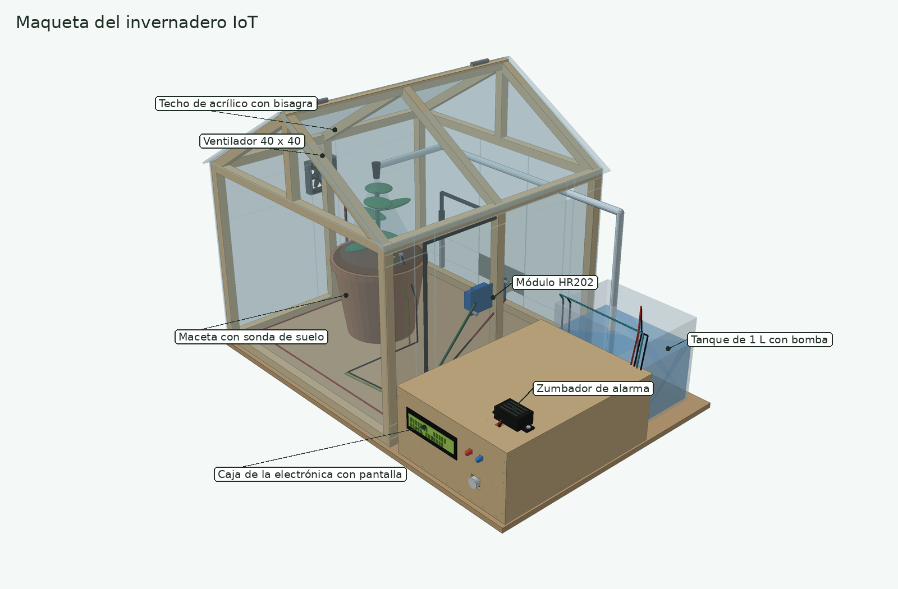
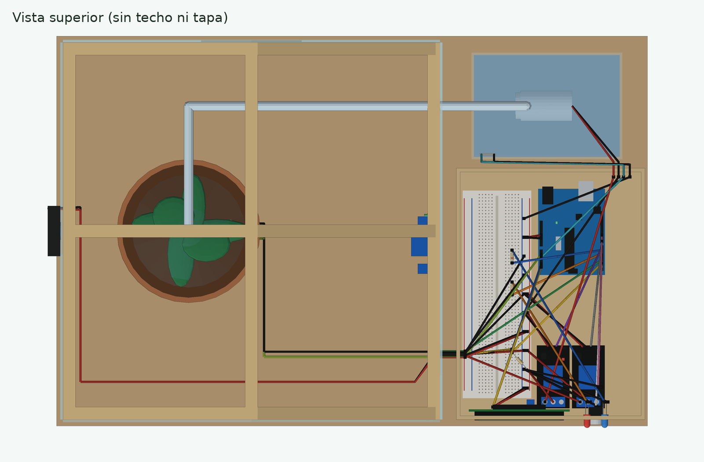
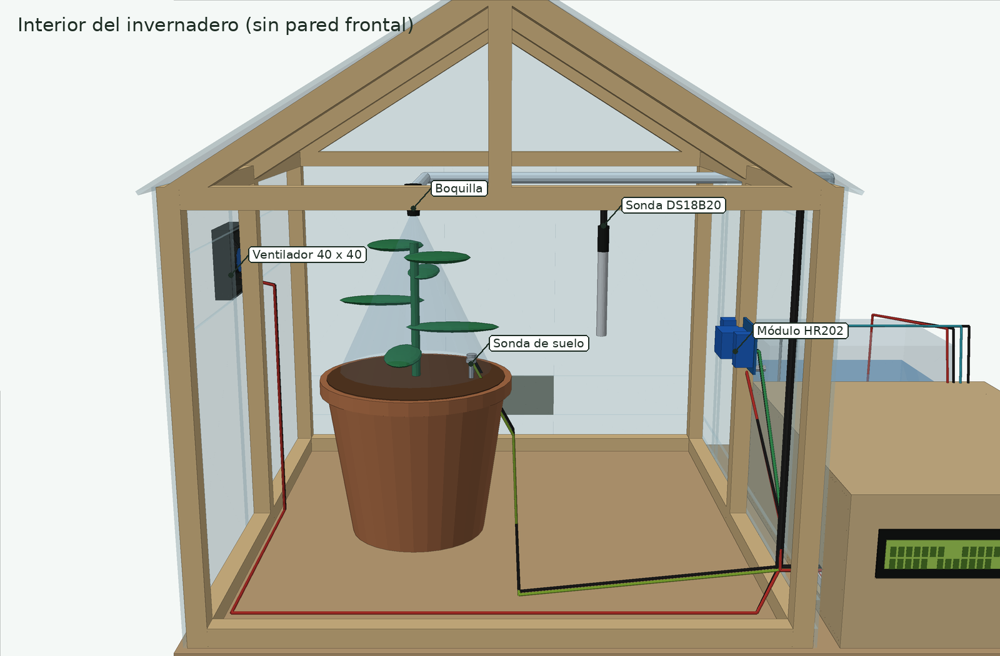
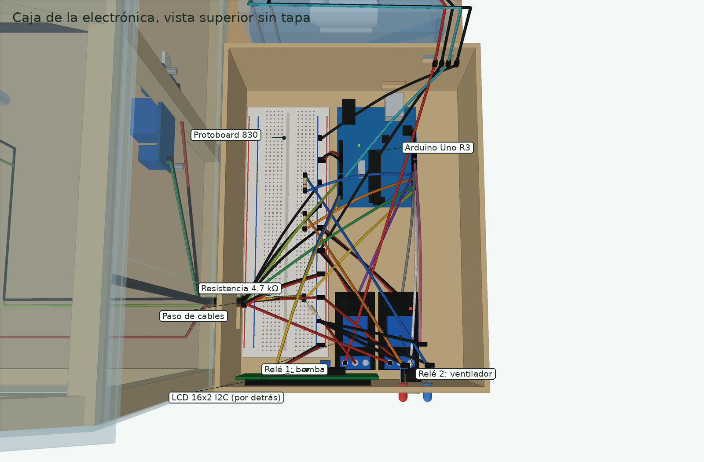
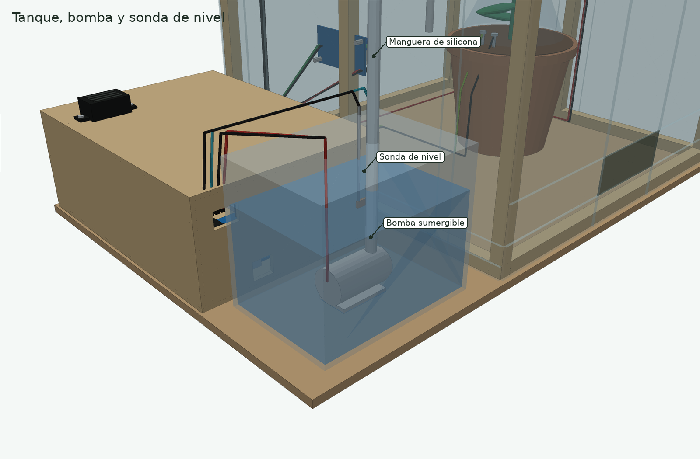
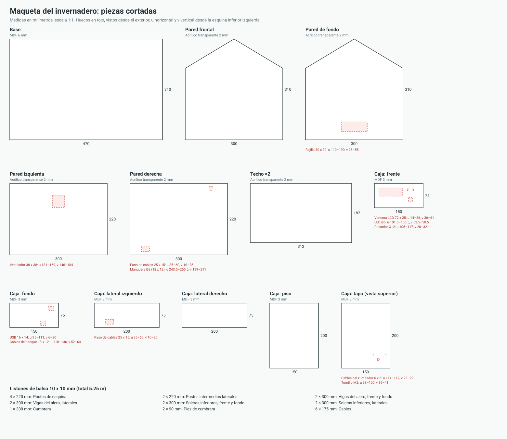

# Maqueta

La maqueta reúne en una base de 470 × 310 mm el invernadero, la caja de la electrónica y el tanque de agua. Los componentes del modelo 3D reproducen la forma y las medidas de las piezas reales, y su ubicación coincide con la maqueta construida.

| Archivo | Contenido |
|---|---|
| [`hardware/3d-models/maqueta-completa.obj`](../hardware/3d-models/maqueta-completa.obj) + `.mtl` | Modelo completo con colores (Blender, Windows 3D Viewer, Fusion) |
| [`hardware/3d-models/maqueta-completa.stl`](../hardware/3d-models/maqueta-completa.stl) | Modelo completo; GitHub lo muestra en 3D |
| `hardware/3d-models/<parte>.stl` | Base y estructura, paredes y techo, caja, electrónica, interior, tanque y bomba, cableado |
| [`hardware/maqueta/planos-de-corte.svg`](../hardware/maqueta/planos-de-corte.svg) | Cada pieza a escala 1:1 con sus huecos |
| [`hardware/maqueta/planta-distribucion.svg`](../hardware/maqueta/planta-distribucion.svg) | Distribución vista desde arriba, con cotas |
| `hardware/maqueta/render-*.png` | Vistas general, interior del invernadero, caja abierta, tanque y planta |

El modelo se genera con `python3 tools/generar_maqueta.py`; todas las medidas son parámetros al inicio del archivo.

## Distribución

| Elemento | Posición sobre la base (x, y) | Dimensiones |
|---|---|---|
| Base | — | 470 × 310 mm, MDF de 6 mm |
| Invernadero | 5–305, 5–305 mm | 300 × 300 mm, 220 mm al alero y 310 mm a la cumbrera |
| Caja de la electrónica | 318–468, 5–205 mm | 150 × 200 × 75 mm |
| Tanque | 330–450, 212–297 mm | 120 × 85 × 100 mm |

La caja queda a 13 mm de la pared derecha del invernadero, con su paso de cables alineado con el de esa pared. El tanque está detrás de la caja, de modo que la manguera sube y entra al invernadero por la misma pared.

## Invernadero

### Estructura

Listón de balso de 10 × 10 mm pegado con pegamento de contacto, 5.3 m en total:

| Pieza | Cantidad | Largo |
|---|---|---|
| Postes de esquina | 4 | 220 mm |
| Postes intermedios en los laterales | 2 | 220 mm |
| Soleras inferiores, frente y fondo | 2 | 300 mm |
| Soleras inferiores, laterales | 2 | 300 mm |
| Vigas del alero, frente y fondo | 2 | 300 mm |
| Vigas del alero, laterales | 2 | 300 mm |
| Cumbrera | 1 | 300 mm |
| Pies de cumbrera | 2 | 90 mm |
| Cabios | 6 | 175 mm |

El techo es a dos aguas, con 90 mm de cumbrera sobre el alero (31° de pendiente). Los cabios van en el frente, en el centro y en el fondo, apoyados entre el alero y la cumbrera. Las soleras están pegadas a la base.

### Cerramiento

Acrílico transparente de 2 mm, pegado por fuera de la estructura con silicona transparente:

| Pieza | Forma | Huecos (u horizontal, v vertical, desde la esquina inferior izquierda vista desde afuera) |
|---|---|---|
| Pared frontal | Pentágono de 300 mm de ancho, 220 mm al alero y 310 mm a la cumbrera | — |
| Pared de fondo | Igual a la frontal | Rejilla de entrada de aire de 80 × 30 mm (u 110–190, v 25–55), cubierta con malla plástica |
| Pared izquierda | 300 × 220 mm | Ventilador de 38 × 38 mm (u 131–169, v 146–184) |
| Pared derecha | 300 × 220 mm | Paso de cables de 25 × 15 mm (u 35–60, v 10–25) y paso de la manguera de 12 × 12 mm (u 243.5–255.5, v 199–211) |
| Techo | Dos paneles de 312 × 182 mm | Sobresalen 6 mm por cada lado |

Los dos paneles del techo se unen en la cumbrera con dos bisagras pequeñas, a 40 mm de cada extremo, y se levantan para acceder al interior. El aire entra por la rejilla del fondo y el ventilador lo extrae por la pared izquierda, de modo que cruza toda la planta.

### Interior

| Componente | Ubicación | Montaje |
|---|---|---|
| Ventilador 40 × 40 × 10 mm | Pared izquierda, centrado a 150 mm del frente y 165 mm de altura | Cuatro tornillos M3 por sus agujeros a 32 mm; sopla hacia afuera |
| Módulo HR202 | Pared derecha por dentro, de 120 a 170 mm del frente y de 105 a 132 mm de altura | Dos separadores de 6 mm; el sensor queda en el aire del invernadero |
| Sonda DS18B20 | Colgada del alero derecho, a 215 mm del borde izquierdo | La punta de acero queda a 120 mm de la base, a la altura de las hojas y lejos de la pared |
| Maceta | Centrada a 105 mm del borde izquierdo y 155 mm del frente | Apoyada en la base |
| Sonda de suelo | Dos clavos de 65 mm a 33 mm del centro de la maceta, separados 12 mm | Clavados 55 mm en la tierra |
| Boquilla | Sobre el centro de la maceta, a 205 mm de la base | Sujeta al extremo de la manguera |

## Caja de la electrónica

MDF de 3 mm con uniones a tope pegadas, de 150 × 200 × 75 mm. La tapa se apoya sobre las paredes y se retira para acceder a la electrónica.

| Pieza | Medidas | Huecos |
|---|---|---|
| Frente | 150 × 75 mm | Ventana de la LCD de 72 × 25 mm (u 14–86, v 36–61); LEDs de Ø5 mm (u 101.5–106.5 y 115.5–120.5, v 53.5–58.5); pulsador de Ø12 mm (u 105–117, v 20–32) |
| Fondo | 150 × 75 mm | Cable USB de 16 × 14 mm (u 95–111, v 6–20); cables del tanque de 18 × 12 mm (u 118–136, v 52–64) |
| Lateral izquierdo | 200 × 75 mm | Paso de cables de 25 × 15 mm (u 35–60, v 10–25), alineado con el del invernadero |
| Lateral derecho | 200 × 75 mm | — |
| Piso | 150 × 200 mm | — |
| Tapa | 150 × 200 mm | Cables del zumbador de 6 × 6 mm y dos agujeros para tornillos M2 a 38 mm |

| Componente | Ubicación |
|---|---|
| Protoboard | A lo largo del lateral izquierdo, con los rieles hacia el paso de cables |
| Arduino Uno | Junto al lateral derecho, sobre separadores de 3 mm, con el conector USB hacia el hueco del fondo |
| Relé 1 (bomba) y relé 2 (ventilador) | Detrás del frente, con las borneras hacia el interior |
| LCD 16×2 | Pegada por dentro del frente, con la pantalla en la ventana |
| LED rojo, LED azul y pulsador | En sus huecos del frente, a la derecha de la pantalla |
| Zumbador | Sobre la tapa, con la rejilla hacia arriba y dos tornillos M2 |

## Tanque y riego

El tanque es un recipiente plástico de 1 L (120 × 85 × 100 mm) lleno hasta unos 70 mm. La bomba está acostada en el fondo, con la salida hacia arriba. La manguera de silicona (6 mm de diámetro interior) sube desde la bomba hasta 205 mm de altura, entra por el hueco de la pared derecha, cruza el invernadero bajo el alero y baja a la boquilla sobre la maceta. Con 100 L/h nominales, cada pulso de 5 s entrega unos 140 mL.

La sonda de nivel son dos cables pegados por dentro de la pared del tanque, con las puntas peladas a 35–40 mm del fondo. Al bajar el agua de ese nivel, la bomba (33 mm de alto) todavía está sumergida.

## Recorrido de los cables

| Cables | Recorrido |
|---|---|
| DS18B20 | Del alero derecho baja por el poste derecho hasta el paso de cables, cruza a la caja y llega a la protoboard |
| Módulo HR202 (VCC, GND, COM, NO) | Por la pared derecha hasta el paso de cables |
| Sonda de suelo | Desde los clavos baja por fuera de la maceta, sigue por la base hasta el paso de cables |
| Ventilador | Baja por el poste izquierdo, cruza la base por el frente del invernadero y sale por el paso de cables |
| Bomba y sonda del tanque | Salen por arriba del tanque y entran a la caja por el hueco del fondo |
| Zumbador | Entra por el hueco de la tapa |
| USB | Sale por el hueco del fondo de la caja |

Dentro del invernadero los cables van sujetos a la estructura con bridas plásticas. Los colores de los cables Dupont coinciden con el [esquema de conexiones](../hardware/circuits/esquema-conexiones.svg): rojo 5 V, negro GND y un color propio para cada señal.

## Planos

