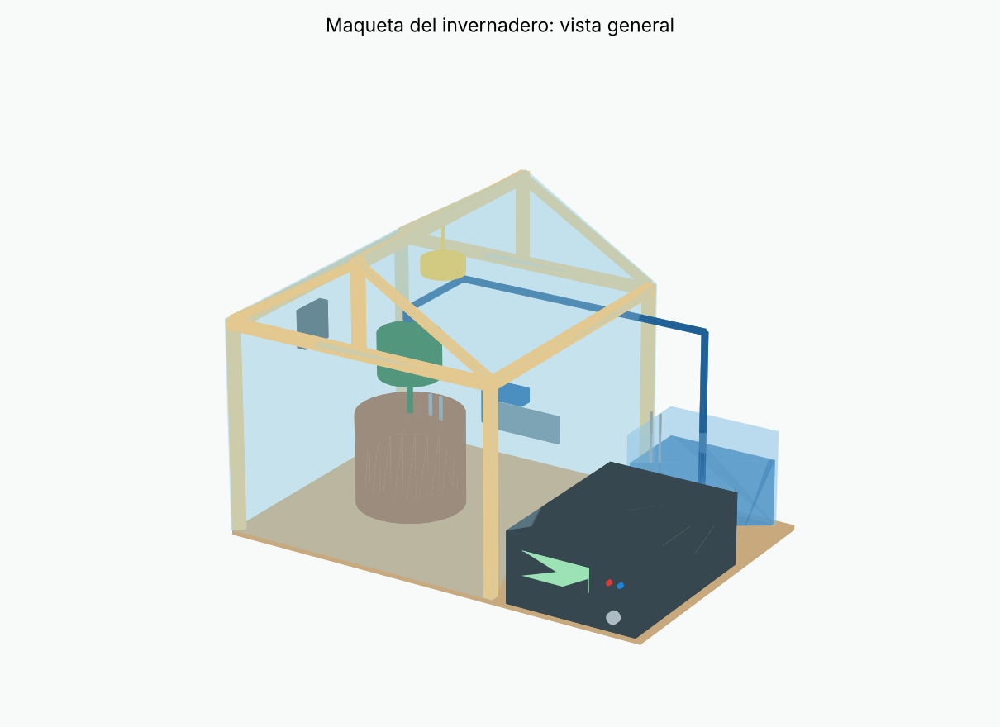
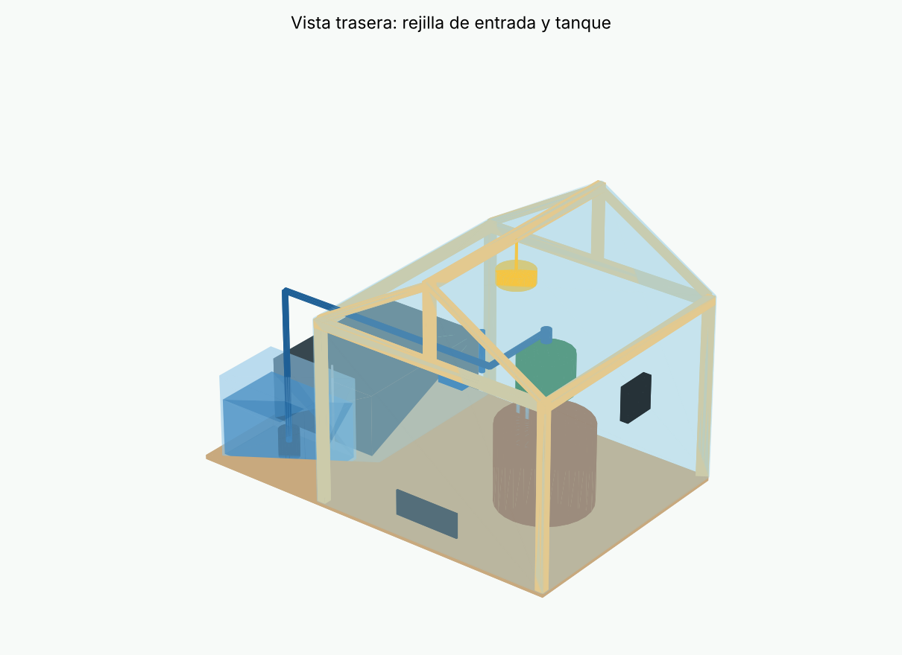

# Montaje de la maqueta

La maqueta tiene tres zonas sobre una base de 46 × 30 cm:

- **Invernadero** (30 × 30 cm, 22 cm hasta el alero y 31 cm hasta la cumbrera): estructura de balso con paredes y techo transparentes. Adentro van la maceta, los sensores, el aspersor y la luz.
- **Caja de la electrónica** (14 × 19 × 7.5 cm): zona seca para el Arduino, la protoboard y los relés. Al frente lleva la pantalla, los LEDs y el pulsador.
- **Tanque de agua** (recipiente de 12 × 8.5 × 10 cm): con la bomba y la sonda de nivel, detrás de la caja.

## Archivos

| Archivo | Para qué |
|---|---|
| [`hardware/maqueta/planos-de-corte.svg`](../hardware/maqueta/planos-de-corte.svg) | Todas las piezas con medidas en mm y los huecos a recortar |
| [`hardware/3d-models/maqueta-completa.stl`](../hardware/3d-models/maqueta-completa.stl) | Modelo 3D completo (GitHub lo muestra en 3D al abrirlo) |
| `hardware/3d-models/*.stl` | Cada parte por separado: base, estructura, paredes y techo, caja, tanque, interior |
| [`tools/generar_maqueta.py`](../tools/generar_maqueta.py) | Genera todo lo anterior; las medidas se cambian en la sección PARÁMETROS |

**Para ver o editar el 3D:**
- En **Tinkercad**: crea un diseño 3D, pulsa **Importar** y elige un archivo `.stl`. Cada parte se importa como un bloque.
- También sirven Fusion 360, FreeCAD o el visor 3D de Windows.

**Para imprimir los planos a tamaño real:** abre el SVG en Inkscape o LibreOffice Draw. Allí puedes imprimir pieza por pieza, o simplemente medir con regla a partir de las cotas.

## Materiales y herramientas

La lista completa está en el [BOM](../hardware/bom/BOM.md#maqueta). Herramientas: bisturí o cúter, regla metálica, escuadra, pistola de silicona caliente, lija fina y taladro o punzón para los huecos pequeños.

## Paso a paso

1. **Base.** Corta el tablero de 46 × 30 cm. Marca con lápiz las tres zonas: invernadero a la izquierda (30 × 30), caja adelante a la derecha (14 × 19) y tanque detrás de la caja.

2. **Estructura.** Corta los palitos de balso según la lista de los planos (unos 3.3 m en total). Pega los 4 postes de 22 cm en las esquinas del invernadero y únelos arriba con las vigas de 30 cm. Luego pega los pies de cumbrera de 9 cm en el centro del frente y del fondo, la cumbrera de 30 cm encima y los 4 cabios inclinados de 17.5 cm. Usa la escuadra para que todo quede a 90°.

3. **Huecos de las paredes.** Antes de pegarlas, recorta:
   - **Pared izquierda:** hueco de 38 × 38 mm para el ventilador, arriba en el centro.
   - **Pared de fondo:** rejilla de 80 × 30 mm abajo, cubierta con malla. Por ahí entra el aire que saca el ventilador, así el aire cruza el invernadero.
   - **Pared derecha:** paso de cables de 25 × 15 mm abajo, y hueco de Ø 8 mm para la manguera, arriba, a 20.5 cm de la base.

4. **Paredes y techo.** Pega el acetato a la estructura con silicona o cinta doble faz transparente. Deja **sin pegar una de las aguas del techo** (sujétala con cinta), para poder abrirla y mantener la planta.

5. **Ventilador.** Fíjalo por fuera en el hueco de la pared izquierda, con la etiqueta hacia afuera. Los ventiladores soplan por el lado de la etiqueta, así que de esta forma **saca** el aire del invernadero.

6. **Caja de la electrónica.** Arma la caja con las piezas de MDF o cartón paja. En el frente van la ventana de la LCD (72 × 25 mm), los dos LEDs (Ø 5 mm) y el pulsador (Ø 12 mm). En el fondo va el hueco para el USB del Arduino, y en el lateral izquierdo el paso de cables hacia el invernadero, alineado con el de la pared. La tapa va suelta o con bisagra de cinta, para poder abrir la caja.

7. **Electrónica.** Monta la protoboard, el Arduino y los tres relés dentro de la caja, con cinta doble faz. Cablea según [conexiones](../hardware/circuits/conexiones.md). Pasa por el paso de cables los del DS18B20, el HR202, la sonda de suelo y el ventilador.

8. **Tanque y bomba.** Pon el recipiente detrás de la caja. Pega la bomba al fondo con silicona y la sonda de nivel en la pared interior, a la altura mínima de agua. Conecta la manguera a la bomba y llévala por fuera hasta el hueco de la pared derecha. Por dentro, sujétala con abrazaderas de alambre a 20.5 cm de altura hasta quedar encima de la maceta, y pon la boquilla mirando hacia abajo.

9. **Interior.**
   - **Maceta:** a la izquierda, debajo de la boquilla.
   - **Sonda de suelo:** clavada en la maceta.
   - **HR202:** colgado en el centro, a unos 12 cm de altura y lejos de la boquilla, para que el rocío no lo moje directamente.
   - **DS18B20:** colgado al lado del HR202, a la sombra.
   - **Luz:** colgada de la cumbrera.

10. **Prueba final.** Llena el tanque, conecta el USB y sigue la tabla [Probar cada parte](manual-usuario.md#probar-cada-parte) del manual.

## Consejos

- **Agua lejos de la electrónica.** Ningún cable con corriente debe quedar debajo de la boquilla. La caja de la electrónica va siempre fuera del invernadero.
- **Sella el paso de cables** con un poco de plastilina o silicona, para que no entre humedad a la caja.
- **Etiqueta los cables** con cinta de papel (D2, A0, etc.). Ayuda mucho si algo hay que revisar durante la presentación.
- **Si el acetato se arquea**, usa acrílico de 2 mm o refuerza los bordes con más balso.
