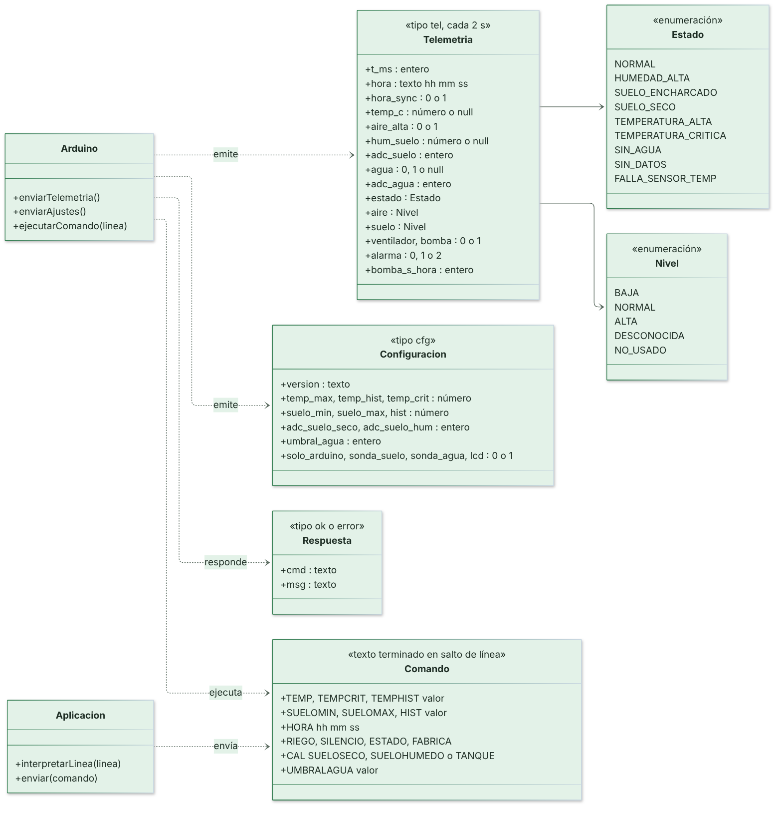

# Protocolo serie

El Arduino y el computador se comunican por USB a **9600 baudios**, con un mensaje por línea terminado en salto de línea. Lo usan la aplicación de monitoreo, el Monitor Serie del Arduino IDE y cualquier programa que abra el puerto.

- **Del Arduino al computador:** las líneas que empiezan por `{` son JSON; las que empiezan por `#` son mensajes legibles (arranque, avisos y ayuda).
- **Del computador al Arduino:** comandos de texto, sin distinguir mayúsculas de minúsculas, de hasta 39 caracteres.



## Comandos

En el Monitor Serie del Arduino IDE se usa **9600 baudios** y el final de línea **«Nueva línea»**.

| Comando | Efecto | Rango | Ejemplo |
|---|---|---|---|
| `AYUDA` o `?` | Lista los comandos | — | `AYUDA` |
| `ESTADO` | Envía la configuración (línea `cfg`) | — | `ESTADO` |
| `TEMP valor` | Temperatura a partir de la cual ventila (°C) | 0–60 | `TEMP 28` |
| `TEMPCRIT valor` | Temperatura de alarma (°C) | `TEMP`–80 | `TEMPCRIT 35` |
| `TEMPHIST valor` | Histéresis de temperatura (°C) | 0.1–10 | `TEMPHIST 2` |
| `SUELOMIN valor` | Suelo seco por debajo de (%) | 0–100 | `SUELOMIN 30` |
| `SUELOMAX valor` | Suelo encharcado por encima de (%) | `SUELOMIN`–100 | `SUELOMAX 85` |
| `HIST valor` | Histéresis del suelo (%) | 0–30 | `HIST 5` |
| `HORA hh:mm[:ss]` | Pone en hora el reloj interno | 00:00–23:59 | `HORA 14:30` |
| `RIEGO` | Un pulso de riego manual | — | `RIEGO` |
| `SILENCIO` | Silencia la alarma 10 minutos | — | `SILENCIO` |
| `CAL SUELOSECO` | Guarda la lectura actual como suelo seco | — | `CAL SUELOSECO` |
| `CAL SUELOHUMEDO` | Guarda la lectura actual como suelo húmedo | — | `CAL SUELOHUMEDO` |
| `CAL TANQUE` | Con los cables en el agua, fija el umbral entre esa lectura y 1023 | — | `CAL TANQUE` |
| `UMBRALAGUA valor` | Umbral de la sonda del tanque, en cuentas del ADC | 1–1022 | `UMBRALAGUA 700` |
| `FABRICA` | Restaura los valores de fábrica de `Config.h` | — | `FABRICA` |

Cada cambio se valida sobre el conjunto completo de ajustes antes de aplicarse. Si es válido, se guarda en la EEPROM (solo los bytes que cambiaron) y el Arduino responde con `ok` y una nueva línea `cfg`. Si no lo es, responde con `error` y la configuración no cambia.

## Mensajes del Arduino

### Telemetría (`tel`), cada 2 s

```json
{"tipo":"tel","t_ms":2000,"hora":"08:00:02","hora_sync":0,"temp_c":24.00,"aire_alta":0,"hum_suelo":50.0,"adc_suelo":625,"agua":1,"adc_agua":250,"estado":"NORMAL","aire":"NORMAL","suelo":"NORMAL","ventilador":0,"bomba":0,"alarma":0,"bomba_s_hora":0}
```

| Campo | Tipo | Significado |
|---|---|---|
| `t_ms` | entero | Milisegundos desde el arranque |
| `hora` | texto | Hora del reloj interno, `hh:mm:ss` |
| `hora_sync` | 0/1 | 1 si el reloj se sincronizó con `HORA` |
| `temp_c` | número o `null` | Temperatura del DS18B20; `null` si no responde |
| `aire_alta` | 0/1 | 1 si el contacto del HR202 está cerrado (humedad sobre el umbral) |
| `hum_suelo` | número o `null` | Humedad del suelo en %; `null` si la sonda está desactivada o no toca tierra |
| `adc_suelo` | entero o `null` | Lectura cruda de la sonda de suelo (0–1023) |
| `agua` | 0/1 o `null` | 1 si hay agua en el tanque; `null` si la sonda está desactivada |
| `adc_agua` | entero o `null` | Lectura cruda de la sonda del tanque |
| `estado` | texto | Estado general, según la tabla siguiente |
| `aire`, `suelo` | texto | `BAJA`, `NORMAL`, `ALTA`, `DESCONOCIDA` o `NO_USADO` |
| `ventilador`, `bomba` | 0/1 | 1 = encendido |
| `alarma` | 0/1/2 | 0 sin alarma, 1 sonando, 2 silenciada |
| `bomba_s_hora` | entero | Segundos de bomba en la hora actual (máximo 900) |

**Estados**, de mayor a menor prioridad:

| `estado` | Significado |
|---|---|
| `FALLA_SENSOR_TEMP` | El DS18B20 no responde; el ventilador queda encendido |
| `SIN_DATOS` | Aún no hay una primera lectura completa |
| `SIN_AGUA` | Tanque vacío; bomba bloqueada |
| `TEMPERATURA_CRITICA` | Temperatura igual o mayor que `TEMPCRIT` |
| `TEMPERATURA_ALTA` | Temperatura sobre `TEMP`; ventilando |
| `SUELO_SECO` | Suelo bajo `SUELOMIN`; regando |
| `SUELO_ENCHARCADO` | Suelo sobre `SUELOMAX`; riego en pausa |
| `HUMEDAD_ALTA` | Contacto del HR202 cerrado; ventilando |
| `NORMAL` | Todo dentro del rango |

### Configuración (`cfg`)

Se envía al arrancar, con `ESTADO` y después de cada cambio aceptado.

```json
{"tipo":"cfg","version":"3.0.0","temp_max":30.0,"temp_hist":2.0,"temp_crit":35.0,"suelo_min":30.0,"suelo_max":85.0,"hist":5.0,"adc_suelo_seco":1000,"adc_suelo_hum":250,"umbral_agua":700,"solo_arduino":1,"sonda_suelo":1,"sonda_agua":1,"lcd":1}
```

Los cuatro últimos campos indican si la alimentación es solo por USB, qué sondas están activas en `Config.h` y si se detectó la pantalla.

### Respuestas

```json
{"tipo":"ok","cmd":"TEMP"}
{"tipo":"error","msg":"Valor fuera de rango"}
```

| Mensaje de error | Causa |
|---|---|
| `Valor fuera de rango` | El ajuste resultante no pasa la validación |
| `Falta el valor` | Comando numérico sin número |
| `Uso: HORA hh:mm[:ss]` | Hora mal escrita |
| `Uso: CAL SUELOSECO\|SUELOHUMEDO\|TANQUE` | Punto de calibración desconocido |
| `Sin agua en el tanque` | `RIEGO` con el tanque vacío |
| `La bomba esta regando o se agoto el cupo de la hora` | `RIEGO` durante un pulso o con el tope horario cumplido |
| `Comando demasiado largo` | Línea de 40 caracteres o más |
| `Comando desconocido. Escribe AYUDA` | Nombre de comando no válido |

## Sesión de ejemplo

```text
# Smart Greenhouse IoT v3.0.0
# DS18B20 detectados: 1
# Pantalla LCD detectada
{"tipo":"cfg","version":"3.0.0","temp_max":30.0, ...}
> HORA 14:30
{"tipo":"ok","cmd":"HORA"}
> temp 28
{"tipo":"ok","cmd":"TEMP"}
{"tipo":"cfg","version":"3.0.0","temp_max":28.0, ...}
> SUELOMAX 20
{"tipo":"error","msg":"Valor fuera de rango"}
> RIEGO
{"tipo":"ok","cmd":"RIEGO"}
```

La secuencia completa entre la aplicación y el Arduino está en [`diagramas/secuencia-app-arduino.png`](diagramas/secuencia-app-arduino.png).
