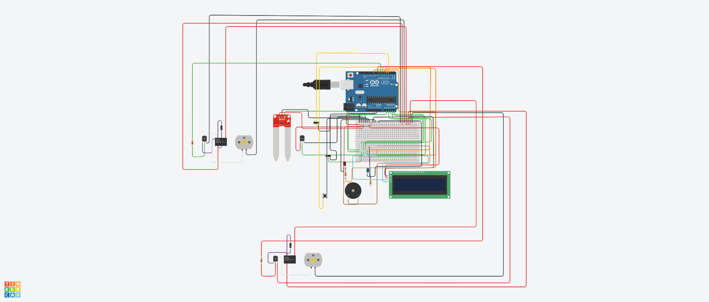

# Simulación en Tinkercad Circuits

El circuito completo está reproducido en Tinkercad Circuits, lo que permite probar el control en el navegador y mostrarlo sin el hardware. Tinkercad no tiene todas las piezas del invernadero, así que se usan equivalentes con el mismo comportamiento eléctrico. El código de la simulación es [`tinkercad/invernadero_tinkercad.ino`](../tinkercad/invernadero_tinkercad.ino).

**Diseño:** [Fabulous Densor-Waasa en Tinkercad](https://www.tinkercad.com/things/ckFm3G2RFop-fabulous-densor-waasa/editel?returnTo=https%3A%2F%2Fwww.tinkercad.com%2Fdashboard&sharecode=71Am6oTvSApW-1JlmwnVTSqvfnvpZX53oYo7AuHwRA4)



Arriba a la izquierda, el relé y el motor de la bomba; abajo, los del ventilador. En el centro, el Arduino, la protoboard y los sensores; a la derecha, la pantalla.

## Piezas equivalentes

| Pieza real | Pieza en Tinkercad | Motivo |
|---|---|---|
| Arduino Uno R3 | Arduino Uno R3 | Igual |
| DS18B20 | Temperature Sensor [TMP36] | Tinkercad no tiene el DS18B20 |
| Módulo HR202 con relé | Slideswitch | Reproduce el contacto NO/COM: una posición es aire húmedo y la otra aire normal |
| Sonda de suelo de dos clavos | Soil Moisture Sensor | Mismo principio resistivo |
| Sonda del tanque | Slideswitch | Una posición es tanque con agua y la otra vacío |
| Módulo relé (×2) | Relay SPDT + NPN Transistor + Diode + Resistor de 1 kΩ | Es el circuito que trae el módulo por dentro |
| Bomba y ventilador | DC Motor (×2) | |
| Zumbador piezoeléctrico | Piezo | |
| LCD 16×2 I2C | LCD 16 x 2 (I2C) | Tipo **PCF8574**, dirección 32 (0x20), librería LiquidCrystal_I2C |
| Pulsador | Pushbutton | |
| LEDs y resistencias | LED rojo, LED azul y Resistor de 220 Ω | Igual |

## Circuito

| Pieza | Terminal | Conexión |
|---|---|---|
| TMP36 (cara plana al frente) | Izquierda (+Vs) / centro (Vout) / derecha (GND) | 5 V / **A3** / GND |
| Slideswitch de humedad del aire | Común / un extremo | **D3** / GND |
| Soil Moisture Sensor | VCC / GND / SIG | 5 V / GND / **A1** |
| Slideswitch del tanque | Común / un extremo | **A2** / GND |
| Pushbutton | Una patita / la diagonal | **D4** / GND |
| LED rojo | Ánodo, con 220 Ω / cátodo | **D5** / GND |
| LED azul | Ánodo, con 220 Ω / cátodo | **D6** / GND |
| Piezo | + / − | **D10** / GND |
| LCD 16 x 2 (I2C) | GND / VCC / SDA / SCL | GND / 5 V / **A4** / **A5** |

Cada relé (bomba en **D7** y ventilador en **D8**). Los números son los terminales del «Relay SPDT» de Tinkercad, que se ven al pasar el cursor:

| Pieza | Conexión |
|---|---|
| Resistencia de 1 kΩ | Del pin del Arduino a la base del transistor NPN |
| Transistor NPN | Emisor a GND; colector al **terminal 5** (bobina) |
| Bobina del relé | **Terminal 8** a 5 V |
| Diodo | Ánodo al terminal 5, cátodo (franja) al terminal 8 |
| Común | **Terminal 1** a 5 V |
| Contacto normalmente abierto | **Terminal 6** al motor; el otro borne del motor a GND |

El **terminal 7** es el contacto normalmente cerrado: un motor conectado ahí gira con el relé en reposo y se detiene al activarlo.

La pantalla de Tinkercad viene configurada por defecto con el expansor MCP23008; la librería LiquidCrystal_I2C solo funciona con el **PCF8574**, que se elige en la propiedad **Tipo** de la pieza. Con el MCP23008 la pantalla queda en blanco.

### Nombres y colores

Cada pieza lleva un nombre en el inspector de Tinkercad (`Tanque agua`, `Humedad aire`, `Humedad suelo`, `Temperatura`, `Boton riego`, `LED suelo seco`, `LED aire humedo`, `Alarma`, `Bomba`, `Ventilador`, `Rele bomba`, `Rele ventilador`, `Pantalla`) y los cables siguen un código por función:

| Color | Función |
|---|---|
| Rojo | 5 V |
| Negro | GND |
| Verde | Sensores analógicos (A1, A2, A3) |
| Amarillo | Entradas de contacto (D3, D4) |
| Naranja | Indicadores: LEDs y piezo (D5, D6, D10) |
| Violeta | Control de los relés: resistencia, transistor, diodo y bobina |
| Blanco | Salida de los relés hacia los motores |
| Azul / turquesa | SDA / SCL de la pantalla |

Los slideswitch usan el pull-up interno del Arduino, igual que el contacto real del módulo HR202: cerrado a GND significa aire húmedo o tanque con agua.

## Pantalla y monitor serie

La pantalla alterna dos páginas, cada una durante 4 s:

```
T:24.8C  HR:OK        SUELO SECO
S:50% Agua:OK         V:0 B:1    08:00
```

Un cambio de estado salta de inmediato a la segunda página. Las acciones del usuario se muestran en la primera fila con una duración mínima de lectura: `Riego manual`, `Riego remoto` y `Ya esta regando` 3 s; `Alarma callada` y `Tanque sin agua` 4 s; `Ajuste guardado` 2,5 s. Un aviso que llega mientras otro lleva menos de 1,5 s en pantalla espera su turno. La pantalla solo reescribe las filas que cambian, por lo que se refresca cinco veces por segundo sin frenar el control.

El monitor serie muestra una línea de estado cuando algo cambia, y cada 5 s si todo sigue igual:

```
T=24.8C  HR=OK  HS=0%  Agua=OK  | SUELO SECO | V0 B1
```

## Comportamiento verificado

Posición de partida de cada prueba: tanque con agua, aire normal, suelo al 50 % y 24 °C.

| # | Acción | Resultado |
|---|---|---|
| 1 | Iniciar la simulación | Saludo durante 3 s; luego lecturas, `NORMAL`, motores detenidos |
| 2 | Suelo al 0 % | `SUELO SECO`, LED rojo, bomba 3 s encendida y 10 s en pausa, en ciclo |
| 3 | Subir el suelo | Sigue seco hasta el 34 %; desde el 35 % vuelve a `NORMAL` |
| 4 | Suelo sobre el 85 % | `SUELO MOJADO`, sin riego |
| 5 | TMP36 a 31 °C | `TEMP ALTA`, ventilador encendido |
| 6 | Bajar a 29 °C y a 27 °C | Sigue ventilando a 29 °C; se apaga por debajo de 28 °C |
| 7 | 31 °C y suelo seco | Durante cada pulso de la bomba el ventilador se detiene; nunca `V1 B1` |
| 8 | Interruptor de humedad del aire | A los 3 s: `HR:ALTA`, LED azul, ventilador |
| 9 | Pulsador | `Riego manual`, bomba durante 3 s |
| 10 | Interruptor del tanque en vacío | `SIN AGUA`, LED rojo intermitente, tres pitidos cada 15 s, riego bloqueado |
| 11 | Pulsador con la alarma sonando | `Alarma callada`; el LED sigue intermitente mientras falte agua |
| 12 | TMP36 a 36 °C | `TEMP CRITICA`, ventilador y pitidos |
| 13 | `AYUDA`, `ESTADO`, `TEMP 25`, `RIEGO` en el monitor | Lista de comandos, umbrales, `OK TEMP`, `OK RIEGO` |

## Diferencias con el equipo real

- **Tiempos más cortos:** pulsos de riego de 3 s con pausas de 10 s (en el real, 5 s y 1 min), porque la simulación corre más lenta que el tiempo real.
- **Muestreo cada 250 ms** en lugar de cada 2 s; el antirrebote del contacto de humedad se ajusta a 12 lecturas para conservar los 3 s.
- **Menos comandos:** `AYUDA`, `ESTADO`, `TEMP`, `SUELOMIN`, `SUELOMAX` y `RIEGO`. No guarda los ajustes en la EEPROM ni tiene calibración.
- **Comandos sin fin de línea:** el monitor serie de Tinkercad envía el texto sin Enter, así que un comando se ejecuta tras 100 ms sin caracteres nuevos.
- **Pulsador por interrupción:** D4 usa la interrupción de cambio de pin PCINT20 para no perder pulsaciones cortas mientras se escribe en la pantalla.
- **Monitor serie en texto legible** en lugar de JSON, por lo que la aplicación de monitoreo no se conecta a Tinkercad.
- **Relés activos en alto:** el transistor invierte la lógica respecto a los módulos reales, que se activan en bajo.
- **Sensor de temperatura analógico:** el TMP36 se lee por A3 en lugar del bus 1-Wire en D2.

La lógica de decisión es la misma: histéresis, antirrebote del contacto de humedad, prioridad de la bomba sobre el ventilador, bloqueo sin agua y riego manual.
