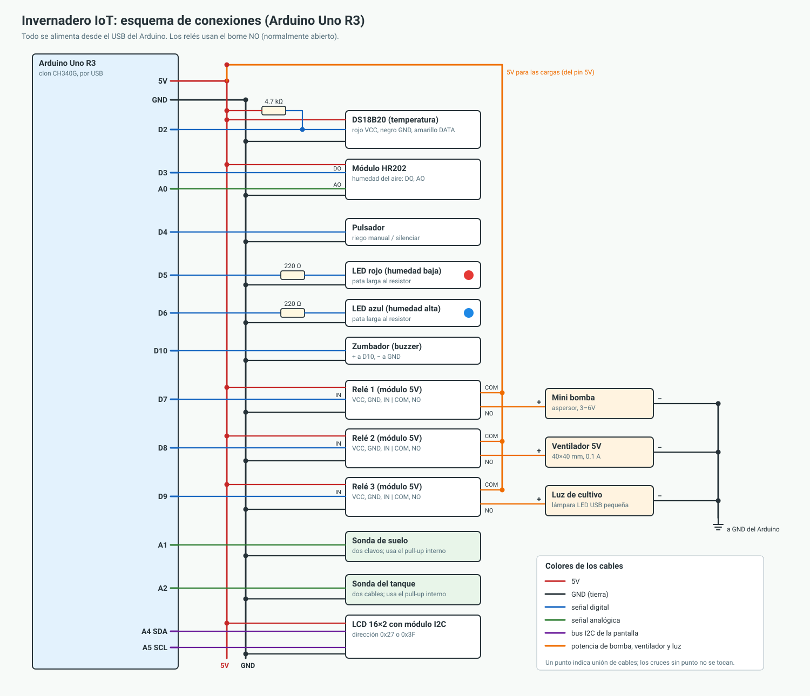

# Conexiones



El esquema se genera con `python3 tools/generar_esquema.py`. Los pines están definidos en [`firmware/include/Config.h`](../../firmware/include/Config.h).

## Distribución

El Arduino y la protoboard de 830 puntos están dentro de la caja de la electrónica. Los rieles de la protoboard reparten 5 V (riel rojo) y GND (riel azul) a todos los módulos. Los cables hacia el invernadero salen por el paso de cables lateral, y los del tanque por el hueco posterior de la caja ([maqueta](../../docs/maqueta.md)).

| Pin | Conectado a | Detalle |
|---|---|---|
| 5V | Riel + de la protoboard | Alimenta módulos, sensores, pantalla y cargas |
| GND | Riel − de la protoboard | Tierra común |
| D2 | DS18B20, cable amarillo (DATA) | Resistencia de 4.7 kΩ entre D2 y 5 V |
| D3 | Módulo HR202, borne NO | Borne COM a GND; entrada con `INPUT_PULLUP` |
| D4 | Pulsador | La otra pata a GND; pull-up interno |
| D5 | LED rojo, a través de 220 Ω | Cátodo a GND |
| D6 | LED azul, a través de 220 Ω | Cátodo a GND |
| D7 | Relé 1, pin IN | Bomba |
| D8 | Relé 2, pin IN | Ventilador |
| D10 | Zumbador, cable rojo (+) | Cable negro a GND |
| D13 | LED de la placa | Parpadea en cada muestra |
| A1 | Sonda de suelo, clavo 1 | Clavo 2 a GND |
| A2 | Sonda del tanque, cable 1 | Cable 2 a GND |
| A4 | LCD I2C, SDA | |
| A5 | LCD I2C, SCL | |

D9, D11, D12, A0 y A3 quedan libres.

## Sensores

### DS18B20 sumergible

| Cable | Destino |
|---|---|
| Rojo (VDD) | 5 V |
| Negro (GND) | GND |
| Amarillo (DATA) | D2, con 4.7 kΩ a 5 V |

La resistencia de 4.7 kΩ está en la protoboard, entre la fila del cable amarillo y el riel de 5 V. Sin ella el bus 1-Wire no funciona y el firmware reporta el sensor como desconectado.

### Módulo de humedad HR202 con relé

El módulo tiene un conector de dos pines (VCC y GND) y una bornera de tres tornillos (NO, COM y NC) que pertenece a su relé. No tiene salida de señal: su comparador LM393 compara la humedad con el umbral del potenciómetro y activa el relé. Ese relé se usa como contacto seco.

| Terminal del módulo | Destino |
|---|---|
| VCC | 5 V |
| GND | GND |
| COM (bornera) | GND |
| NO (bornera) | D3 |
| NC (bornera) | Sin conectar |

Con el aire bajo el umbral, NO está abierto y D3 lee alto por su pull-up interno. Con el aire sobre el umbral, el relé cierra NO con COM y D3 lee bajo. Por el contacto solo circula la corriente del pull-up (unos 0.1 mA).

### Sondas resistivas

Las dos sondas usan el mismo principio: un electrodo en un pin analógico con el pull-up interno del Arduino (unos 35 kΩ) y el otro electrodo a GND. Cuanta más agua hay entre los electrodos, menor es la lectura. El firmware activa el pull-up solo durante la medición, unos milisegundos cada 2 s, para reducir la corrosión.

| Sonda | Electrodos | Conexión |
|---|---|---|
| Suelo | Dos clavos galvanizados de 65 mm, separados 12 mm, clavados 55 mm en la tierra | A1 y GND |
| Tanque | Dos cables con 5 mm de punta pelada, separados 10 mm, a 35 mm del fondo | A2 y GND |

La sonda del tanque está por encima de la bomba (33 mm de alto): el sistema considera el tanque vacío antes de que la bomba quede fuera del agua.

## Actuadores

### Módulos relé

Los dos módulos son de 1 canal con optoacoplador y relé de 5 V (JQC-3FF-S-Z, 10 A). Se activan con nivel bajo en IN, por eso el firmware los inicializa en alto antes de configurar el pin como salida y no hacen clic al arrancar. El jumper JD-VCC queda puesto, uniendo la alimentación de la bobina con VCC.

| Pin del módulo | Destino |
|---|---|
| VCC | 5 V |
| GND | GND |
| IN | D7 (relé 1) o D8 (relé 2) |
| COM | 5 V |
| NO | + de la carga |
| NC | Sin conectar |

```
 5 V ──┬── COM [Relé 1] NO ──── (+) Bomba        (−) ──┐
       └── COM [Relé 2] NO ──── (+) Ventilador   (−) ──┤
                                                       │
 GND ──────────────────────────────────────────────────┘
```

El borne NO deja la carga apagada si el Arduino se reinicia o se desconecta.

### Bomba sumergible

Cable rojo al NO del relé 1 y cable negro a GND. Funciona sumergida, acostada en el fondo del tanque, con la salida hacia arriba.

### Ventilador 40 × 40 mm

Cable rojo al NO del relé 2 y cable negro a GND. El conector JST de dos pines se reemplaza por terminales Dupont hembra. Se monta en la pared izquierda del invernadero y extrae el aire hacia afuera.

### Zumbador piezoeléctrico activo

Cable rojo a D10 y cable negro a GND. Tiene oscilador interno: suena con solo recibir voltaje continuo, por eso `ZUMBADOR_PASIVO = false`. Consume unos 12 mA a 5 V, dentro de los 20 mA recomendados para un pin del Arduino. Está atornillado sobre la tapa de la caja y sus cables entran por un hueco de 6 × 6 mm.

## Interfaz local

| Componente | Conexión |
|---|---|
| LED rojo 5 mm | D5 → 220 Ω → ánodo (pata larga); cátodo a GND |
| LED azul 5 mm | D6 → 220 Ω → ánodo; cátodo a GND |
| Pulsador 12 mm | Una pata a D4 y la otra a GND |
| LCD 16×2 con módulo I2C (PCF8574) | GND, VCC a 5 V, SDA a A4, SCL a A5 |

El firmware detecta la pantalla en 0x27 o 0x3F. El contraste se ajusta con el potenciómetro azul del módulo I2C.

## Alimentación y consumo

Todo se alimenta del USB del Arduino (5 V, 500 mA), conectado a un computador o a un cargador de 5 V. Con `ALIMENTACION_SOLO_ARDUINO = true` la bomba y el ventilador nunca funcionan a la vez.

| Situación | Consumo aproximado |
|---|---|
| Reposo (Arduino, LCD, sensores) | 85 mA |
| Ventilando, con el aire húmedo | 350 mA |
| Regando, con el aire húmedo, alarma y LEDs | 495 mA |

El desglose está en la [especificación técnica](../../docs/especificacion-tecnica.md#7-energía).

## Lista de verificación eléctrica

- [ ] Resistencia de 4.7 kΩ entre D2 y 5 V.
- [ ] Cada LED con su resistencia de 220 Ω y la pata larga hacia el pin.
- [ ] Bomba y ventilador conectados al borne NO de su relé, nunca directo a un pin.
- [ ] D3 conectado al borne NO del módulo HR202, no al NC.
- [ ] Clavos de la sonda de suelo sin tocarse entre sí.
- [ ] Bomba sumergida antes de energizar.
